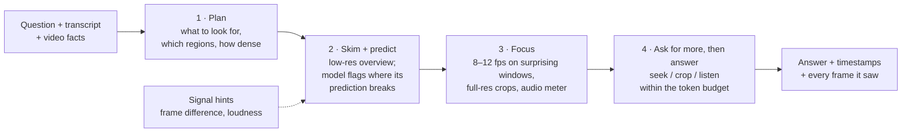
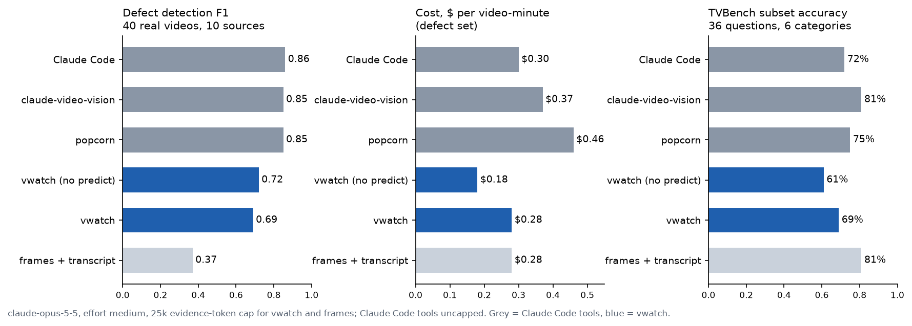

<div align="center">

# vwatch

**An agent toolkit that watches video the way a person does, plus an eval harness that checks whether that beats uniform frame sampling.**

[](https://github.com/kashaf12/vwatch/actions/workflows/ci.yml)
[](LICENSE)
[](pyproject.toml)
[](https://www.anthropic.com/claude)


</div>

> **Result so far (2026-11-22):** on 40 real videos with injected defects, vwatch beats plain frame sampling by **+32 pp F1** (CI +12 to +55), but a plain Claude Code agent running its own ffmpeg analysis beats vwatch by **16 pp** (CI −30 to −2) at about the same cost. vwatch is faster and capped; Claude Code is more accurate. Details in [Head-to-head](#head-to-head-with-claude-code-video-tools).

## Why

The default way to give a video to a language model is to sample frames evenly (say one per second) and send them with a transcript. Anything shorter than the gap between two frames can fall through: a flash frame, a half-second freeze, a dropped word, a price that is on screen for 400 ms. More frames help, but you pay for every one of them, including the hundreds where nothing happens.

People don't watch like that. They know what they are looking for, skim, notice when something breaks their expectation, and look closely there. vwatch gives a model the same loop and the tools to do it within a fixed token budget, then measures whether it actually helps.

## How it watches



1. **Plan first.** Before seeing a frame, the model reads the question, the video facts and the Whisper transcript, and writes down what it is looking for, which screen regions need a close look, and how densely to sample.
2. **Skim and predict.** It gets a cheap low-resolution overview (or, for a clip short enough to fit the budget, the whole clip at watchable size) plus hints from model-free signals (frame difference, loudness), which play the role of the retina. It predicts what should happen between frames and flags where that prediction is uncertain or wrong.
3. **Focus.** The most surprising windows are served at 8–12 fps, with full-resolution crops of the planned regions and an audio meter.
4. **Ask for more.** It can request extra `seek` / `crop` / `listen` calls within the budget, then answers with timestamps. Every frame, crop and audio window it looked at is logged, so a claim about a moment it never saw can be caught.

## Quickstart

You need Python 3.11+, [uv](https://docs.astral.sh/uv/), `ffmpeg` on `PATH`, and either an `ANTHROPIC_API_KEY` or a logged-in [Claude Code](https://claude.com/claude-code) (see [Model backends](#model-backends)).

```bash
git clone https://github.com/kashaf12/vwatch.git
cd vwatch
uv sync --all-extras
uv run vw --help
```

Ask a question about any video:

```bash
uv run vw watch path/to/video.mp4 -q "Is there any moment where the on-screen price contradicts the narration?" --language hi
```

It prints the answer, then one line per moment it cites (`mm:ss.ss  what happened`), and on stderr how many frames and crops it looked at, the evidence tokens, the cost and the wall time. The first run downloads the Whisper `small` model; transcripts are cached in `~/.cache/vwatch/`.

Compare against plain frames on the same question, or get everything as JSON:

```bash
uv run vw watch path/to/video.mp4 -q "..." --arm B1      # uniform frames + transcript, same budget
uv run vw watch path/to/video.mp4 -q "..." --json        # answer, raw output, cost, turns, every frame/crop it saw
uv run vw watch path/to/video.mp4 -q "..." --budget 10000 --effort low
```

See only the model-free signal hints (free, no model call):

```console
$ uv run vw signals clip.mp4        # a public-domain speech clip with a 3-frame black flash injected at 44.27 s
- 00:24.77–00:24.83 local_change (score 0.30): change confined to one region
- 00:44.27–00:44.37 flash (score 1.00): 3 frame(s) differ from both neighbours
```

Hints are not verdicts: a held frame before an edit looks like a freeze, an edit in the source looks like a jump cut, and a sentence pause looks like an audio dropout. Deciding which is which is the model's job. `eval/bench/eval_signals.py` measures the detectors alone (recall, precision, false alarms per clean minute) with no model calls.

## Results

Pilot run, 2026-11-22: `claude-opus-5-5`, 19 pilot videos (13 T1, 2 each of T2–T4), one repeat, 25k evidence-token budget. Full report: [`eval/results/pilot-2026-11-22.md`](eval/results/pilot-2026-11-22.md).

**Verdict: ITERATE.** Promising on short events, not yet good enough to ship, and the sample is small.

| Metric (W vs B1 at matched budget) | B1: frames + transcript | W: vwatch | Δ | 95% CI |
|---|---|---|---|---|
| T2 recall on events < 1 s | 58.3% | **100%** | +41.7 pp | [+28.6, +60.0] |
| T1 defect F1 | 0.60 | **0.76** | +16.2 pp | [−25.0, +44.6] |
| T1 localization ±0.5 s (target ≥ 90%) | 54.5% | 72.7% | +18.2 pp | n/a |
| T1 false alarms on clean videos (target ≤ 5%) | 50% | 50% | 0 | n/a |
| T3 causal link recall | 85.7% | 100% | +14.3 pp | [0.0, +33.3] |
| Cost, $ per video-minute | $0.317 | $0.431 | 1.36× | n/a |
| Claims about moments it never looked at | 0 | 0 | | |

<p align="center">
  
  
</p>

**What works**

- **Short events.** On events under 0.5 s, uniform frames (B0, B1) catch 29%, twice the frame budget (B2) catches 71%, and vwatch catches 100% at the original budget. This is the only ship criterion with a confidence interval clear of zero.
- **The question-first plan earns its place.** Removing it (W-noQ) costs 16.9 pp of T1 F1, CI [+6.0, +22.7].
- **The signal hints matter, and so does the method around them.** Removing the hints (W-noS) drops short-event recall from 100% to 33%. Giving plain frames the same hint text (B1H) does not close the gap: T1 F1 0.55 vs 0.76.
- **Cost is within budget.** 1.36× B1's $ per video-minute (target ≤ 1.5×). No unseen-frame claims in any arm.

**What doesn't (yet)**

- **The T1 win is not significant.** The CI for defect F1 spans zero because all T1 videos come from 4 source clips, and the bootstrap is clustered by clip.
- **False alarms.** Both arms report a defect on 1 of the 2 clean pilot videos. Target is ≤ 5%.
- **Jump cuts:** 0% for both arms. **Frozen frames:** B1 100%, vwatch 0%. The watcher's focus windows don't yet catch "nothing changed" defects.
- **The prediction step adds nothing measurable.** Signals-only attention (W-noP) scores 0.80 T1 F1 vs W's 0.76 and costs 35% less. Crops didn't help T1 either (W-noCrop 0.80).
- **Slower.** About 52 s of wall time per video-minute vs 14 s for B1, from the multi-turn loop.

### Head-to-head with Claude Code video tools

<!-- BENCHMARK:START -->
Same model (`claude-opus-5-5`, effort medium) and the same task prompts for every arm. vwatch and the frame baseline run under a 25k evidence-token cap; the Claude Code tools are uncapped, because that is how they are used. Reports: [defects](eval/results/bench-defects-t1x-2026-11-22.md), [TVBench](eval/results/bench-tvbench-2026-11-22.md), [TVBench held-out](eval/results/bench-tvbench-heldout-2026-11-22.md).

<p align="center"></p>

**Defect detection.** 40 openly licensed speech videos from 10 sources in 7 languages, each with one injected defect or none (T1x, [sources](docs/DATA.md)). 240 runs.

| Arm | F1 | Precision | Recall | $ / video-min | s / video-min | Flash | Freeze | Jump cut | Dropout |
|---|---|---|---|---|---|---|---|---|---|
| Plain Claude Code | **0.86** | 0.92 | 0.80 | $0.30 | 66 | 7/7 | 6/7 | 3/8 | 8/8 |
| claude-video-vision | 0.85 | 1.00 | 0.73 | $0.37 | 61 | 7/7 | 5/7 | 2/8 | 8/8 |
| popcorn | 0.85 | 0.86 | 0.83 | $0.46 | 102 | 7/7 | 6/7 | 5/8 | 7/8 |
| vwatch without prediction (W-noP) | 0.72 | 1.00 | 0.57 | **$0.18** | 24 | 7/7 | 3/7 | 0/8 | 7/8 |
| vwatch (W) | 0.69 | 0.82 | 0.60 | $0.28 | 36 | 7/7 | 3/7 | 0/8 | 8/8 |
| Frames + transcript (B1) | 0.37 | 0.88 | 0.23 | $0.28 | **8** | 1/7 | 5/7 | 1/8 | 0/8 |

Paired differences, bootstrapped over the 10 source clips: W − B1 **+32.4 pp** [+11.5, +54.7]; W − Claude Code **−16.5 pp** [−29.8, −2.0]; W − claude-video-vision −15.4 pp [−28.1, −4.6]; W − popcorn −15.5 pp [−28.5, −4.6]. No arm raised a false alarm on the 10 clean videos.

**Public benchmark (TVBench subset).** 36 multiple-choice questions over 6 temporal categories: frames + transcript 81%, claude-video-vision 81%, popcorn 75%, Claude Code 72%, vwatch 69%. vwatch lost most on 5-second counting clips, where it skimmed at low resolution instead of looking at every frame. After adding a rule to watch short clips in full, it scored 96% on the 24 held-out questions, tied with Claude Code and claude-video-vision; that held-out set turned out easier for every arm (frames + transcript 88%).

**What this says.**

- Uniform frames are blind to anything shorter than the sampling gap: 1 of 7 flash frames, 0 of 8 audio dropouts. Every agentic approach fixes that.
- The Claude Code agents won by doing what vwatch's detectors do, but more thoroughly: in most runs they ran ffmpeg filters such as `signalstats`, `silencedetect`, scene scores and `freezedetect` over the whole video, then looked at montages of the suspicious moments. That is why they catch freezes and jump cuts and vwatch doesn't.
- vwatch's advantages are a fixed token cap, repeatable behaviour, a log of every frame it looked at, and speed (36 s per video-minute vs 61–102 s). Its prediction step still doesn't pay for itself: W-noP is as accurate and 35% cheaper.
- All runs were made through the Claude Code CLI on a Claude plan. Costs are as reported by the backend.
<!-- BENCHMARK:END -->

## Eval harness

Every arm gets the **same model, the same task prompt and the same videos**; only how the video reaches the model changes. The headline comparison is at a **matched evidence-token budget**: every image and text block sent counts against the cap (images at w×h/750 tokens). Billed tokens, which include re-sent conversation history in the watcher's multi-turn loop, are reported separately as cost. The full protocol, metrics and ship/kill thresholds are in [docs/eval-protocol.md](docs/eval-protocol.md).

### Arms

| Arm | What reaches the model |
|---|---|
| B0 | N evenly spaced frames, no audio. How video is usually handled today. |
| B1 | B0 plus a timestamped Whisper transcript. **The main baseline.** |
| B2 | B1 at twice the budget. Is vwatch just buying more frames? |
| B1H | B1 plus the exact signal-hint text W receives. Isolates the method from the detectors. |
| W | vwatch: plan, skim + predict, focus, act. |
| W-noQ / W-noP / W-noCrop / W-noS | W without the plan / the prediction step (signals only) / crops / signal hints. |
| CC | Plain headless Claude Code (`claude -p`, normal system prompt) with Bash limited to ffmpeg/ffprobe and a few read-only commands, plus Read. |
| CVV | CC + the [claude-video-vision](https://github.com/jordanrendric/claude-video-vision) plugin, prompted with `/claude-video-vision:watch-video`; local whisper.cpp `small` for audio. |
| POP | CC + the [popcorn](https://github.com/haithamelmengad/popcorn) MCP server (mlx-whisper / faster-whisper in its own venv). |

CC, CVV and POP are reference arms, not part of ship/kill. They are **not budget-capped** (that is how those tools are used), so compare them on accuracy, billed cost and wall time, not on the matched-budget curve.

### Tasks

| ID | Task | Ground truth |
|---|---|---|
| T1 | Defect detection: flash frame, frozen frame, jump cut, audio dropout, blocked caption, wrong on-screen number | Injected by script into clean real videos, so exact. T1x adds the generic types on Wikimedia Commons speech videos in six languages. |
| T2 | Short-event recall: "list every event", scored by event duration bucket | Procedurally rendered clips; the generator writes the event list |
| T3 | Causal retell: one "because" per sentence | Procedural cause→effect chains with distractors; scored by an LLM judge with a fixed rubric |
| T4 | Targeted QA: five questions per video, one right answer each | Procedural clips |
| T5 | Public benchmark check: 60 multiple-choice clips from TVBench | Benchmark labels |

How each set is built: [docs/dataset-spec.md](docs/dataset-spec.md). Sources and licenses: [docs/DATA.md](docs/DATA.md).

### Reproduce

Video files are not in the repo. Build the dataset locally (the procedural tasks need only ffmpeg; T1x and T5 download from Wikimedia Commons and Hugging Face; T1 needs your own clean videos, see [docs/DATA.md](docs/DATA.md#t1-bring-your-own-videos)):

```bash
uv run vw dataset build --root eval/data --scale full --seed 7 --tasks T2 T3 T4   # procedural clips
uv run python -m vwatch.dataset.t1x --root eval/data --seed 7                     # Commons speech videos + defects
uv run python -m vwatch.dataset.tvbench --root eval/data --per-category 10 --seed 7
```

Run arms and write the report (these call the model and cost money, see below):

```bash
uv run vw eval run --split pilot --tasks T2,T3 --arms B0,B1,B2,W,W-noQ,W-noP,W-noCrop --budget 25000
uv run vw eval report --runs 'eval/runs/*.jsonl' --root eval/data --budget 25000 --judge --out eval/results/pilot.md
```

- `eval run` is resumable: re-running skips finished (video, task) pairs and retries failed ones. Records go to `eval/runs/<date>_<arm>_<budget>k_r<repeat>.jsonl`.
- `--budget 10000,25000,50000,100000` gives the Pareto curve; `--repeats 3` is the full-run protocol; `--ids-file eval/bench/t5_ids.txt` runs a fixed id list.
- `eval report` without `--judge` makes no model calls (T3 is then n/a). With `--judge` it scores T3 with an LLM judge (default `sonnet`).

**External arms.** `scripts/setup_external.sh` clones claude-video-vision, popcorn and whisper.cpp at pinned commits into `vendor/` (gitignored), builds them and downloads their models; nothing is installed into `~/.claude` or system-wide. It needs git, node ≥ 24, npm, uv and ffmpeg.

```bash
scripts/setup_external.sh
uv run vw eval run --split pilot --tasks T1 --arms CC,CVV,POP --budget 25000
```

Each external run copies the video to a fresh temp dir under a neutral name, runs `claude` there with no user settings, CLAUDE.md, hooks, plugins or MCP servers (`--setting-sources ""`, `--strict-mcp-config`), `--permission-mode dontAsk` with an allowlist and no web tools, kills the process tree after 15 min (`VWATCH_EXT_TIMEOUT_S`), and audits every tool call. A call that touches a path outside the workdir, the repo or a truth file turns the run into an `audit:` error, which counts as a failure. Tool calls and the audit are logged to `eval/runs/external/`.

**Cost notes.** In the pilot, per video-minute: B1 $0.32, B2 $0.60, W $0.43 (prices as reported by the backend). External arms are uncapped, so their cost depends on how much the agent chooses to look at. A full run is every arm × every video × 3 repeats, so start with `--split pilot`, `--limit` or `--per-bucket` to size it. With the Claude Code backend, eval runs count against your Claude plan's usage limits.

## Model backends

| Backend | When | Notes |
|---|---|---|
| Anthropic SDK | `ANTHROPIC_API_KEY` is set | Billed to your API account. Installed by `uv sync --all-extras` (the `api` extra). |
| Claude Code CLI | no API key, or `VWATCH_BACKEND=cli` | Runs `claude -p` in stream-json mode with no tools, no MCP and a replaced system prompt. Uses your logged-in Claude Code, so **usage counts against your Claude plan**. Set `VWATCH_CLAUDE_BIN` if `claude` is not on `PATH`. |

The default model is `claude-opus-5-5` (`--model` to change it, `--effort` for reasoning effort).

| Variable | Default | Purpose |
|---|---|---|
| `VWATCH_BACKEND` | auto | `cli` forces the Claude Code CLI even when an API key is set |
| `VWATCH_WHISPER_MODEL` | `small` | faster-whisper model name |
| `VWATCH_WHISPER_DEVICE` | `auto` | `auto` tries `mps`, then falls back to CPU int8; set `cuda` for an NVIDIA GPU or `cpu` |
| `VWATCH_CACHE` | `~/.cache/vwatch` | transcript cache |
| `VWATCH_EXT_TIMEOUT_S` | 900 | per-run timeout for the external arms |
| `VWATCH_VENDOR_DIR` / `VWATCH_EXT_LOG_DIR` | `vendor/` / `eval/runs/external/` | where the external tools live and where their logs go |

## Repo layout

| Path | What |
|---|---|
| `src/vwatch/cli.py` | The `vw` command |
| `src/vwatch/media.py`, `imaging.py` | ffmpeg I/O, frame grids, crops, timestamps, token estimates |
| `src/vwatch/signals.py` | Model-free perception: flashes, cuts, freezes, silences, local changes |
| `src/vwatch/detectors.py` | Full-pass freeze and jump-cut detectors (mid-res stillness, catch-up jump, audio splice click on a frame boundary) |
| `src/vwatch/transcribe.py` | Whisper transcript with word timestamps, cached |
| `src/vwatch/llm/` | Backends: Anthropic SDK, Claude Code CLI, a fake for tests, the T3 judge |
| `src/vwatch/arms/` | `watcher.py` (W and ablations), `tools.py` (overview / seek / crop / listen), `baseline.py` (B0/B1/B2/B1H), `external*.py` (CC/CVV/POP, sandbox and audit) |
| `src/vwatch/tasks.py` | Task prompts (identical across arms) and answer parsing |
| `src/vwatch/dataset/` | Dataset builders: defect injection (T1, T1x), procedural clips (T2–T4), TVBench (T5) |
| `src/vwatch/evaluation/` | Runner, scoring, statistics (clustered bootstrap, McNemar), criteria, report and charts |
| `eval/results/` | Reports and charts |
| `eval/bench/` | Fixed video-id lists for benchmark runs |
| `docs/` | [Eval protocol](docs/eval-protocol.md), [dataset spec](docs/dataset-spec.md), [data and licenses](docs/DATA.md) |
| `scripts/setup_external.sh` | Pinned install of the third-party tools for the external arms |
| `tests/` | ~550 tests; fakes only, no network or model calls |

## Roadmap

From the pilot verdict, in rough order:

- [ ] **Close the gap to Claude Code on defects.** Add full-pass detectors like the ones the agents improvised (ffmpeg `freezedetect`, `signalstats`, audio/video seam checks for jump cuts), since freezes and jump cuts are where all of the gap is.
- [ ] **Rework or drop the prediction step.** It adds cost without measurable gain over signals-only attention (W-noP), on both the pilot and the defect benchmark.
- [ ] **More sources.** T1 rests on 4 source clips; more (the T1x Commons set is the start) narrows the confidence intervals more than anything else.
- [ ] **Full run**: all arms × all videos × 3 repeats, thresholds locked first.
- [x] **Head-to-head** with plain Claude Code, claude-video-vision and popcorn (2026-11-22, above).
- [ ] **A Gemini-backed comparison**, since Gemini takes video natively.

## Contributing

Issues and PRs are welcome. See [CONTRIBUTING.md](CONTRIBUTING.md) for setup and the ground rules (tests use fakes only, small immutable modules, and any change to the watcher comes with before/after eval numbers).

```bash
uv sync --all-extras
uv run pytest -q
```

## Citation

If you use vwatch or its eval harness, please cite:

```bibtex
@software{vwatch2026,
  author  = {kashaf12},
  title   = {vwatch: an agent toolkit that watches video like a person},
  year    = {2026},
  version = {0.1.0},
  url     = {https://github.com/kashaf12/vwatch},
  license = {MIT}
}
```

GitHub's "Cite this repository" button reads [CITATION.cff](CITATION.cff). If you use the T5 subset, also cite TVBench ([docs/DATA.md](docs/DATA.md#t5-tvbench-subset)).

## License

Code: [MIT](LICENSE). Datasets keep their own licenses and are not redistributed here; see [docs/DATA.md](docs/DATA.md).

## Acknowledgements

- [TVBench](https://huggingface.co/datasets/FunAILab/TVBench) (Cores et al., BMVC 2025) for the T5 subset.
- [Wikimedia Commons](https://commons.wikimedia.org/) and the authors of the openly licensed videos used in T1x ([full list](docs/DATA.md#t1x-wikimedia-commons-speech-videos)).
- [popcorn](https://github.com/haithamelmengad/popcorn) and [claude-video-vision](https://github.com/jordanrendric/claude-video-vision), the Claude Code video tools used as reference arms.
- [faster-whisper](https://github.com/SYSTRAN/faster-whisper) for transcripts, [whisper.cpp](https://github.com/ggml-org/whisper.cpp) (used by claude-video-vision) and [FFmpeg](https://ffmpeg.org/) for everything media.
