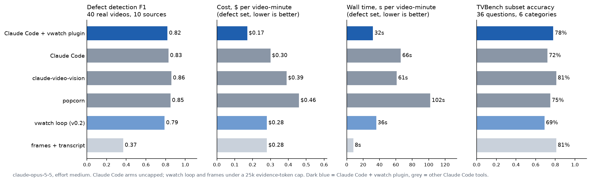

<div align="center">

# vwatch

**Let your agent watch local videos the way a person does: skim, notice what's off, look closer, cite the time.**

[](https://github.com/kashaf12/vwatch/actions/workflows/ci.yml)
[](https://github.com/kashaf12/vwatch/actions/workflows/fresh-install.yml)
[](LICENSE)
[](pyproject.toml)



</div>

vwatch gives your agent eyes and ears for video files on your machine: timestamped frame grids, dense seeks, crops, a transcript, a loudness meter and model-free hints about where something looks wrong. A skill teaches it how to use them without burning tokens on frames where nothing happens.

## Install in Claude Code

```
/plugin marketplace add kashaf12/vwatch
/plugin install vwatch@vwatch
```

That's it on macOS and Linux. On first start the plugin fetches [uv](https://docs.astral.sh/uv/), Python, vwatch and a static ffmpeg by itself (one-time download: about 170 MB on Apple Silicon, 350 MB on Linux; a system ffmpeg is used instead if you have one). Windows: see [the Windows notes](docs/mcp.md#windows).

## Use it with other agents

The tools are a standard MCP server, so any agent that supports MCP and image results can use them:

| Agent | Setup |
|---|---|
| **Codex** | add `[mcp_servers.vwatch]` to `~/.codex/config.toml`, plus the skill (checked: it finds the same glitches as Claude Code) |
| **Gemini CLI** | `gemini extensions install https://github.com/kashaf12/vwatch` |
| **Cursor, VS Code, opencode, Windsurf, Claude Desktop** | one JSON block in the agent's MCP config |

Copy-paste setups for each: [docs/agents.md](docs/agents.md).

## Usage

```
/vwatch:watch ~/renders/promo-v3.mp4 Any flash frames, freezes, jump cuts or audio dropouts?
/vwatch:watch talk.mp4 What is on screen when the speaker says "quarterly revenue"?
/vwatch:watch lecture.mp4 Summarize this with a timestamp for each section
/vwatch:watch bug-report.mov Read the error message that appears near the end
```

Leave out the question and you get a description of what happens, with times.

Or just ask about a video in plain words; the `watch-video` skill loads on its own:

> "Check ~/Desktop/final-cut.mp4 for glitches before I upload it."
>
> "When does the presenter first show the pricing slide in demo.mp4?"

## What you get

| | What it does |
|---|---|
| `video_info` | Duration, fps, size, audio and speech, and what an overview or seek will cost. Call it first. |
| `video_transcript` | Timestamped speech from a local whisper model, optionally word by word or for one window. |
| `video_signals` | Free hints from every frame and the audio: flash, freeze, cut, jump cut, silence in speech, local change. |
| `video_overview` | The whole video as tiled frame grids with times burned in; short clips come back whole. |
| `video_seek` | Up to 16 consecutive frames in a window, up to 30 fps, for a close look at one moment. |
| `video_crop` | One frame cropped to a region at full resolution, for small text, faces and logos. |
| `video_listen` | Loudness every 0.1 s and the words heard in a window, for audio glitches. |
| `watch-video` skill | The method below, with a cheat sheet of which signal to check for which problem and a token budget. |
| `/vwatch:watch` | `/vwatch:watch <path> [question]` runs the method on one file. |

The tools make **no model calls and need no API key**: your agent does the looking, so the only cost is its own usage. Every response starts with a line saying which times it shows and roughly how many tokens it costs, so your agent can budget. For example, `video_signals` on a 50 s clip:

```
SIGNALS: 31 of 31 candidate moments (top 40 by score, in time order). Model-free hints ...
- 00:13.30–00:13.70 local_change (score 0.30): change confined to one region
- 00:13.43–00:13.53 flash (score 1.00): 3 frame(s) differ from both neighbours
- 00:15.73–00:15.73 cut_in_speech (score 0.75): picture changes abruptly while sound is on
```

Hints are not verdicts (a sentence pause looks like an audio dropout); the skill has your agent confirm each one by looking or listening. Full reference: [docs/mcp.md](docs/mcp.md).

## How it works

An AI model can't watch a video. It only sees the pictures it is handed, and every picture costs money. A one-minute video has 1,800 frames, so agents usually look at about one frame per second. A glitch that lasts one frame (1/30 of a second) is then almost never seen.

vwatch works like a security guard with motion sensors:

1. **Sensors first, free.** Before the AI sees anything, vwatch measures every frame and the whole soundtrack on your machine, in seconds and without any AI. It measures how much each frame differs from the one before, which part of the picture changed, and how loud the sound is every 1/50 of a second. Simple rules turn those numbers into alarms:
   - **flash:** the picture jumps away and comes straight back within 1–4 frames;
   - **freeze:** the picture stays exactly the same while the sound continues;
   - **jump cut:** the picture jumps and the audio clicks on the same frame;
   - **audio dropout:** the sound drops to dead silence mid-sentence.
2. **One glance at everything.** The agent sees one grid of small thumbnails across the whole video, to understand what it is about.
3. **Rewind only at the alarms.** At each alarm, or wherever the question points, the agent looks at every frame of that half-second, zooms into a region, or listens. Everywhere else it never looks closely, which is where the savings come from.
4. **Answer with times.** Each finding comes with its timestamp and the tool that showed it, so you can check it yourself.

Alarms are hints, not verdicts: a natural pause can look like a dropout. The [`watch-video`](plugins/vwatch/skills/watch-video/SKILL.md) skill tells the agent to confirm or dismiss each one by looking or listening before it reports anything.

## Results

<!-- RESULTS:START -->
<p align="center"></p>

Same model (`claude-opus-5-5`) and the same prompts for every arm, on 40 openly licensed speech videos (10 sources, 7 languages), each with one injected glitch or none, plus 36 TVBench questions:

| | Defect F1 | Recall | $ / video-min | s / video-min | TVBench |
|---|---|---|---|---|---|
| **Claude Code + vwatch plugin** | 0.85 | **0.83** | **$0.17** | **33** | 78% |
| Plain Claude Code | 0.83 | 0.80 | $0.30 | 66 | 72% |
| claude-video-vision | **0.86** | 0.76 | $0.39 | 61 | **81%** |
| popcorn | 0.85 | 0.83* | $0.46 | 102 | 75% |
| Frames + transcript | 0.37 | 0.23 | $0.28 | 8 | **81%** |

<sub>Defect columns: 3 runs each for the plugin, Claude Code and claude-video-vision; *1 run for popcorn and frames.</sub>

**How to read this.**
- **Recall:** of the real glitches in the videos, how many were found (0.83 = 83%).
- **Defect F1:** one score from 0 to 1 that is high only when a tool finds most glitches *and* rarely reports a glitch that isn't there.
- **$ / video-min and s / video-min:** the cost and the time to check one minute of video.
- **TVBench:** accuracy on a public multiple-choice video quiz.

- **As accurate as the best tools, at half the cost and twice the speed.** The accuracy differences between the Claude Code tools are too small to tell apart on 40 videos: the plugin is 0.8 points below claude-video-vision, and the statistical uncertainty runs from −10 to +8. It finds the most glitches (83% vs 80% and 76%), but 13% of its reports are wrong, while claude-video-vision makes none. One caveat: the wording of the plugin's hints was revised after reading its mistakes on these same videos, so its numbers are somewhat optimistic until the fresh test set is in.
- **Frames alone miss short glitches.** Uniform frames found 1 of 7 flash frames and 0 of 8 audio dropouts; the plugin found all of both in every run.
- **Not cheaper on very short clips.** On TVBench's 5–30 s clips the skill's fixed setup dominates: $0.48 per video-minute against $0.21 for plain Claude Code.
- **Long videos work.** On a 21-minute lecture with a 2 s on-screen code word and a 1 s freeze spliced in, the plugin found both in 138–159 s (plain Claude Code: 207 s). This is a single video, so treat it as a demonstration, not a ranking.
- **A fresh, pre-registered benchmark is running:** 48 new videos, short and long, with every tool run once under rules [committed before any data was built](docs/fresh-bench-protocol.md). Its results will replace the caveat above.

vwatch's own watcher loop (the standalone CLI below) scores 0.79 F1, up from 0.69 in v0.1. Full tables, charts and caveats: [docs/benchmark.md](docs/benchmark.md).
<!-- RESULTS:END -->

## Standalone CLI

vwatch also runs on its own from a clone, with its own watcher loop (this one calls a model: an `ANTHROPIC_API_KEY` or a logged-in Claude Code):

```bash
uv run vw watch clip.mp4 -q "Is there any moment where the on-screen price contradicts the narration?"
uv run vw signals clip.mp4     # the free signal hints only, no model call
```

Setup, options and the eval commands: [docs/cli.md](docs/cli.md).

## FAQ

**What does the first run download?** uv, Python, vwatch and a static ffmpeg: about 170 MB (~35 s) on Apple Silicon, about 350 MB on Linux x86_64. The whisper model (~480 MB for the default `small`) is fetched only when your agent first asks for a transcript, never in the background, so frame-only use never downloads it. Later starts take about a second. [Details](docs/mcp.md#install).

**How long can videos be?** Long recordings work. Seeks and crops jump straight to the moment (about 0.1 s on a 21-minute file), and when you open a video the server starts its signal scan, and its transcript if the speech model is already on disk, in the background, so they are ready by the time your agent asks.

**Is my video uploaded anywhere?** vwatch reads local files only, refuses URLs, and runs ffmpeg and whisper on your machine. The frames and text it returns become part of your agent's conversation, so they go wherever your agent's model runs, like any image you paste.

**Can I use my own ffmpeg?** Yes. If `ffmpeg` and `ffprobe` are on `PATH`, or `VWATCH_FFMPEG` / `VWATCH_FFPROBE` point at them, nothing is downloaded.

**Windows?** The plugin's launcher is a shell script and is untested on native Windows. Install uv (`winget install astral-sh.uv`) and add the server with `claude mcp add`; see [docs/mcp.md](docs/mcp.md#windows). WSL works like Linux.

**`/mcp` shows vwatch as failed after install.** On a slow connection the first download can outlast Claude Code's MCP startup timeout. Reconnect once it finishes, or start Claude Code with `MCP_TIMEOUT=120000`.

**Which videos work?** Any local file ffmpeg can read (.mp4, .mov, .mkv, .webm, ...). Pass absolute paths when you can.

## Learn more

[Other agents](docs/agents.md) · [Benchmark](docs/benchmark.md) · [Fresh benchmark protocol](docs/fresh-bench-protocol.md) · [Eval harness](docs/eval-harness.md) · [Datasets](docs/DATA.md) · [MCP reference](docs/mcp.md) · [CLI](docs/cli.md) · [Roadmap](docs/roadmap.md) · [Changelog](CHANGELOG.md) · [Contributing](CONTRIBUTING.md)

## License

Code: [MIT](LICENSE). Datasets keep their own licenses and are not redistributed here; see [docs/DATA.md](docs/DATA.md). To cite vwatch, use [CITATION.cff](CITATION.cff) (GitHub's "Cite this repository" button).

## Acknowledgements

[FFmpeg](https://ffmpeg.org/) and [faster-whisper](https://github.com/SYSTRAN/faster-whisper) do the media work; [static-ffmpeg](https://github.com/zackees/static_ffmpeg) and [uv](https://docs.astral.sh/uv/) make the zero-setup install possible. The benchmark uses [TVBench](https://huggingface.co/datasets/FunAILab/TVBench) (Cores et al., BMVC 2025) and openly licensed videos from [Wikimedia Commons](https://commons.wikimedia.org/) ([full list](docs/DATA.md#t1x-wikimedia-commons-speech-videos)), and compares against [claude-video-vision](https://github.com/jordanrendric/claude-video-vision) (with [whisper.cpp](https://github.com/ggml-org/whisper.cpp)) and [popcorn](https://github.com/haithamelmengad/popcorn).
