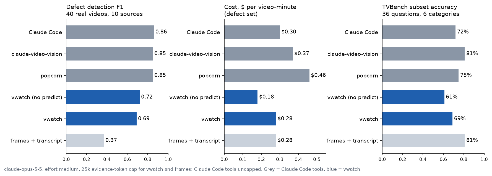
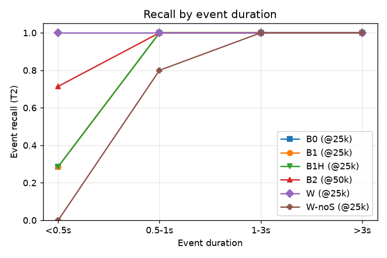

# Benchmark results

Everything vwatch has measured so far, newest first. How the runs are set up (arms, tasks, budgets, how to reproduce) is in [eval-harness.md](eval-harness.md); the full protocol and ship/kill thresholds are in [eval-protocol.md](eval-protocol.md).

**Short version.** vwatch's own watcher loop beats uniform frame sampling clearly (+32 pp defect F1 on 40 real videos), but a plain Claude Code agent running its own ffmpeg analysis beats the watcher (0.86 vs 0.69 F1) at about the same cost. That is why vwatch now ships as tools and a skill for your agent rather than as a second model. Whether your agent does better *with* those tools is the next result below.

- [Claude Code + vwatch plugin (2026-11-23)](#claude-code--vwatch-plugin-2026-11-23)
- [Head-to-head with Claude Code video tools (2026-11-22)](#head-to-head-with-claude-code-video-tools)
- [Pilot (2026-11-22)](#pilot-2026-11-22)
- [Methodology in brief](#methodology-in-brief)
- [Cost notes](#cost-notes)

## Claude Code + vwatch plugin (2026-11-23)

<!-- PLUGIN-RESULTS:START -->
> **Placeholder: results pending.** Arm VWP (plain Claude Code + the vwatch plugin: MCP tools and the `watch-video` skill, prompted with `/vwatch:watch`) against plain Claude Code (CC) and the other video plugins (CVV, POP) on the same T1x defect set and TVBench subset as the head-to-head below. To be filled in when the run finishes.
<!-- PLUGIN-RESULTS:END -->

## Head-to-head with Claude Code video tools

<!-- BENCHMARK:START -->
Same model (`claude-opus-5-5`, effort medium) and the same task prompts for every arm. vwatch and the frame baseline run under a 25k evidence-token cap; the Claude Code tools are uncapped, because that is how they are used. Reports: [defects](../eval/results/bench-defects-t1x-2026-11-22.md), [TVBench](../eval/results/bench-tvbench-2026-11-22.md), [TVBench held-out](../eval/results/bench-tvbench-heldout-2026-11-22.md).

**Defect detection.** 40 openly licensed speech videos from 10 sources in 7 languages, each with one injected defect or none (T1x, [sources](DATA.md)). 240 runs.

| Arm | F1 | Precision | Recall | $ / video-min | s / video-min | Flash | Freeze | Jump cut | Dropout |
|---|---|---|---|---|---|---|---|---|---|
| Plain Claude Code | **0.86** | 0.92 | 0.80 | $0.30 | 66 | 7/7 | 6/7 | 3/8 | 8/8 |
| claude-video-vision | 0.85 | 1.00 | 0.73 | $0.37 | 61 | 7/7 | 5/7 | 2/8 | 8/8 |
| popcorn | 0.85 | 0.86 | 0.83 | $0.46 | 102 | 7/7 | 6/7 | 5/8 | 7/8 |
| vwatch without prediction (W-noP) | 0.72 | 1.00 | 0.57 | **$0.18** | 24 | 7/7 | 3/7 | 0/8 | 7/8 |
| vwatch (W) | 0.69 | 0.82 | 0.60 | $0.28 | 36 | 7/7 | 3/7 | 0/8 | 8/8 |
| Frames + transcript (B1) | 0.37 | 0.88 | 0.23 | $0.28 | **8** | 1/7 | 5/7 | 1/8 | 0/8 |

Paired differences, bootstrapped over the 10 source clips: W − B1 **+32.4 pp** [+11.5, +54.7]; W − Claude Code **−16.5 pp** [−29.8, −2.0]; W − claude-video-vision −15.4 pp [−28.1, −4.6]; W − popcorn −15.5 pp [−28.5, −4.6]. No arm raised a false alarm on the 10 clean videos.

**Public benchmark (TVBench subset).** 36 multiple-choice questions over 6 temporal categories: frames + transcript 81%, claude-video-vision 81%, popcorn 75%, Claude Code 72%, vwatch 69%. vwatch lost most on 5-second counting clips, where it skimmed at low resolution instead of looking at every frame. After adding a rule to watch short clips in full, it scored 96% on the 24 held-out questions, tied with Claude Code and claude-video-vision; that held-out set turned out easier for every arm (frames + transcript 88%).

**What this says.**

- Uniform frames are blind to anything shorter than the sampling gap: 1 of 7 flash frames, 0 of 8 audio dropouts. Every agentic approach fixes that.
- The Claude Code agents won by doing what vwatch's detectors do, but more thoroughly: in most runs they ran ffmpeg filters such as `signalstats`, `silencedetect`, scene scores and `freezedetect` over the whole video, then looked at montages of the suspicious moments. That is why they catch freezes and jump cuts and vwatch doesn't.
- vwatch's advantages are a fixed token cap, repeatable behaviour, a log of every frame it looked at, and speed (36 s per video-minute vs 61–102 s). Its prediction step still doesn't pay for itself: W-noP is as accurate and 35% cheaper.
- All runs were made through the Claude Code CLI on a Claude plan. Costs are as reported by the backend.
<!-- BENCHMARK:END -->

## Pilot (2026-11-22)

`claude-opus-5-5`, 19 pilot videos (13 T1, 2 each of T2–T4), one repeat, 25k evidence-token budget. Full report: [`eval/results/pilot-2026-11-22.md`](../eval/results/pilot-2026-11-22.md).

**Verdict: ITERATE.** Promising on short events, not yet good enough to ship, and the sample is small.

| Metric (W vs B1 at matched budget) | B1: frames + transcript | W: vwatch | Δ | 95% CI |
|---|---|---|---|---|
| T2 recall on events < 1 s | 58.3% | **100%** | +41.7 pp | [+28.6, +60.0] |
| T1 defect F1 | 0.60 | **0.76** | +16.2 pp | [−25.0, +44.6] |
| T1 localization ±0.5 s (target ≥ 90%) | 54.5% | 72.7% | +18.2 pp | n/a |
| T1 false alarms on clean videos (target ≤ 5%) | 50% | 50% | 0 | n/a |
| T3 causal link recall | 85.7% | 100% | +14.3 pp | [0.0, +33.3] |
| Cost, $ per video-minute | $0.317 | $0.431 | 1.36× | n/a |
| Claims about moments it never looked at | 0 | 0 | | |

  
  

**What works**

- **Short events.** On events under 0.5 s, uniform frames (B0, B1) catch 29%, twice the frame budget (B2) catches 71%, and vwatch catches 100% at the original budget. This is the only ship criterion with a confidence interval clear of zero.
- **The question-first plan earns its place.** Removing it (W-noQ) costs 16.9 pp of T1 F1, CI [+6.0, +22.7].
- **The signal hints matter, and so does the method around them.** Removing the hints (W-noS) drops short-event recall from 100% to 33%. Giving plain frames the same hint text (B1H) does not close the gap: T1 F1 0.55 vs 0.76.
- **Cost is within budget.** 1.36× B1's $ per video-minute (target ≤ 1.5×). No unseen-frame claims in any arm.

**What doesn't (yet)**

- **The T1 win is not significant.** The CI for defect F1 spans zero because all T1 videos come from 4 source clips, and the bootstrap is clustered by clip.
- **False alarms.** Both arms report a defect on 1 of the 2 clean pilot videos. Target is ≤ 5%.
- **Jump cuts:** 0% for both arms. **Frozen frames:** B1 100%, vwatch 0%. The watcher's focus windows don't yet catch "nothing changed" defects.
- **The prediction step adds nothing measurable.** Signals-only attention (W-noP) scores 0.80 T1 F1 vs W's 0.76 and costs 35% less. Crops didn't help T1 either (W-noCrop 0.80).
- **Slower.** About 52 s of wall time per video-minute vs 14 s for B1, from the multi-turn loop.

## Methodology in brief

- Every arm gets the **same model, the same task prompt and the same videos**; only how the video reaches the model changes.
- vwatch's watcher (W) and the frame baselines (B0, B1, B2, B1H) are compared at a **matched evidence-token budget**: every image and text block sent counts against the cap (images at w×h/750 tokens). Billed tokens, which include re-sent conversation history in the watcher's multi-turn loop, are reported separately as cost.
- The Claude Code arms (CC, CVV, POP, VWP) are **not budget-capped**, because that is how those tools are used. Compare them on accuracy, billed cost and wall time, not on the matched-budget curve. Each runs sandboxed in a fresh temp dir with a tool-call audit; see [eval-harness.md](eval-harness.md#external-arms).
- Ground truth is exact: defects are injected by script into clean real videos, and the procedural clips' generator writes its own labels ([dataset-spec.md](dataset-spec.md), sources and licenses in [DATA.md](DATA.md)).
- Confidence intervals are bootstrapped and clustered by source clip, so many videos cut from one source don't inflate certainty.
- Known limits: injected defects are cleaner than real faults (digital-zero dropouts, solid overlays), each video has 0 or 1 defect, and the samples are still small.

## Cost notes

In the pilot, per video-minute: B1 $0.32, B2 $0.60, W $0.43 (prices as reported by the backend). External arms are uncapped, so their cost depends on how much the agent chooses to look at. A full run is every arm × every video × 3 repeats, so start with `--split pilot`, `--limit` or `--per-bucket` to size it. With the Claude Code backend, eval runs count against your Claude plan's usage limits.
