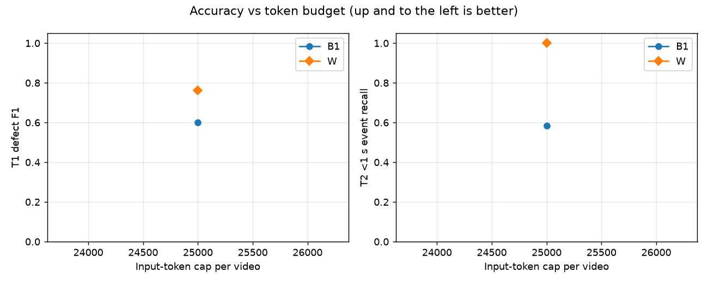

# Benchmark results

Everything vwatch has measured so far, newest first. How the runs are set up (arms, tasks, budgets, how to reproduce) is in [eval-harness.md](eval-harness.md); the full protocol and ship/kill thresholds are in [eval-protocol.md](eval-protocol.md).

**Short version.** With three runs per tool, Claude Code with the vwatch plugin (v0.2.2) finds video defects as well as plain Claude Code and claude-video-vision (F1 0.82 vs 0.83 and 0.86, within noise; recall 0.79 vs 0.80 and 0.76) at about half the cost and twice the speed. Most of its wrong reports are one real edit in a source lecture; counting that as real for every tool, it scores highest (0.87). It is not cheaper on 5–30 s clips. vwatch's own watcher loop went from 0.69 to 0.79 F1 between v0.1 and v0.2, and every tool-using arm beats uniform frame sampling (0.37) by more than 40 pp.

- [Claude Code + vwatch plugin (2026-11-23)](#claude-code--vwatch-plugin-2026-11-23)
- [Head-to-head with Claude Code video tools (2026-11-22)](#head-to-head-with-claude-code-video-tools)
- [Pilot (2026-11-22)](#pilot-2026-11-22)
- [Methodology in brief](#methodology-in-brief)
- [Cost notes](#cost-notes)

## Claude Code + vwatch plugin (2026-11-23)

<!-- PLUGIN-RESULTS:START -->
### Three runs per tool (v0.2.2)

v0.2.2 adds cell-level freeze detection, a digital-silence dropout hint and skill guidance on strong hints (see the [changelog](../CHANGELOG.md)). Detector changes were tuned on a fresh freeze dev set (`eval/bench/make_freeze_dev.py`, disjoint from the benchmark videos); the 40 benchmark videos were only scored. Plugin, plain Claude Code and claude-video-vision ran 3 times each on the same 40 T1x videos; repeats are averaged per video before bootstrapping. Report: [bench-plugin-3runs-2026-11-23.md](../eval/results/bench-plugin-3runs-2026-11-23.md).

| Arm (runs) | F1 | Precision | Recall | $ / video-min | s / video-min | Flash | Freeze | Jump cut | Dropout |
|---|---|---|---|---|---|---|---|---|---|
| claude-video-vision (3) | **0.86** | **1.00** | 0.76 | $0.39 | 61 | 21/21 | 16/21 | 7/24 | 24/24 |
| popcorn (1) | 0.85 | 0.86 | 0.83 | $0.46 | 102 | 7/7 | 6/7 | 5/8 | 7/8 |
| Plain Claude Code (3) | 0.83 | 0.87 | **0.80** | $0.30 | 66 | 21/21 | 18/21 | 9/24 | 24/24 |
| **Claude Code + vwatch plugin v0.2.2 (3)** | 0.82 | 0.86 | 0.79 | **$0.17** | **32** | 21/21 | 15/21 | 11/24 | 24/24 |
| Claude Code + vwatch plugin v0.2.1 (3) | 0.79 | 0.85 | 0.73 | $0.17 | 33 | 20/21 | 13/21 | 12/24 | 21/24 |
| Frames + transcript (1) | 0.37 | 0.88 | 0.23 | $0.28 | 8 | 1/7 | 5/7 | 1/8 | 0/8 |

Paired F1 differences for v0.2.2 (cluster bootstrap over the 10 source clips): plugin − Claude Code −1.2 pp [−11.0, +9.2]; plugin − claude-video-vision −4.0 pp [−11.8, +4.1]; plugin − popcorn −2.7 pp [−11.6, +6.5]; plugin − frames **+45.2 pp** [+24.4, +67.6].

**Where the remaining gap is.** The plugin's recall matches plain Claude Code and beats claude-video-vision; its precision is lower. 10 of its 12 wrong reports in 120 runs are the same moment: a real edit in the `sem` source lecture (the speaker's pose snaps between two frames and the audio clicks), which the dataset labels clean because it assumed the source footage was clean. As a sensitivity check, not the primary result, dropping jump-cut reports at that edit for every tool alike gives F1 plugin **0.871**, claude-video-vision 0.861, popcorn 0.847, plain Claude Code 0.832 (plugin − claude-video-vision +1.0 pp [−7.1, +8.2]).

**What changed from v0.2.1 to v0.2.2.** In the v0.2.1 runs the agent dismissed true hints: a spliced-in flash frame showing the same speaker was "slight movement", and a 1.2 s cut to digital silence was "a pause between sentences". The dropout hint now says when sound drops to exact digital zero in a clip that otherwise keeps room tone (on real recordings every injected dropout is exact zero and every natural pause keeps −58 to −88 dB), the flash hint says the picture returns to where it was, and the skill tells the agent to reject a 0.9+ hint only with direct evidence. Dropouts went from 21/24 to 24/24, flashes from 20/21 to 21/21, and freezes from 13/21 to 15/21.

The TVBench numbers below are from v0.2.0's single run; the v0.2.2 changes only touch defect hints.

### Single run (v0.2.0)

Arm **VWP** is plain headless Claude Code with the vwatch plugin installed (MCP tools + `watch-video` skill), prompted with `/vwatch:watch <video> <task>`. It is sandboxed and audited like the other Claude Code arms, and its MCP server runs from the checkout under test. **W** is vwatch's own watcher loop at v0.2. Both were run on 2026-11-23 with the silent-clip freeze fixes. CC, CVV, POP and B1 are the 2026-11-22 runs below; they don't use vwatch code, so they were not re-run. Reports: [defects](../eval/results/bench-plugin-2026-11-23.md), [TVBench](../eval/results/bench-plugin-tvbench-2026-11-23.md), [TVBench held-out](../eval/results/bench-plugin-tvbench-heldout-2026-11-23.md).

**Defect detection** (the same 40 T1x videos as the head-to-head below).

| Arm | F1 | Precision | Recall | $ / video-min | s / video-min | Flash | Freeze | Jump cut | Dropout | Clean false alarms |
|---|---|---|---|---|---|---|---|---|---|---|
| Plain Claude Code (CC) | **0.86** | 0.92 | 0.80 | $0.30 | 66 | 7/7 | 6/7 | 3/8 | 8/8 | 1/10 |
| claude-video-vision (CVV) | 0.85 | **1.00** | 0.73 | $0.37 | 61 | 7/7 | 5/7 | 2/8 | 8/8 | 0/10 |
| popcorn (POP) | 0.85 | 0.86 | **0.83** | $0.46 | 102 | 7/7 | 6/7 | 5/8 | 7/8 | 2/10 |
| **Claude Code + vwatch plugin (VWP)** | 0.80 | 0.88 | 0.73 | **$0.18** | 34 | 7/7 | 4/7 | 3/8 | 8/8 | 1/10 |
| vwatch loop v0.2 (W) | 0.79 | 0.85 | 0.73 | $0.28 | 36 | 7/7 | 3/7 | 4/8 | 8/8 | 1/10 |
| Frames + transcript (B1) | 0.37 | 0.88 | 0.23 | $0.28 | **8** | 1/7 | 5/7 | 1/8 | 0/8 | 0/10 |

Paired F1 differences, cluster-bootstrapped over the 10 source clips (10,000 resamples):

| Comparison | Δ F1 | 95% CI |
|---|---|---|
| VWP − CC | −5.7 pp | [−16.8, +4.1] |
| VWP − CVV | −4.6 pp | [−17.8, +8.6] |
| VWP − POP | −4.7 pp | [−17.0, +6.6] |
| VWP − W | +1.4 pp | [−2.5, +6.5] |
| VWP − B1 | **+43.2 pp** | [+20.5, +67.0] |
| W − CC | −7.1 pp | [−16.3, +3.1] |
| W − B1 | **+41.7 pp** | [+20.5, +65.1] |

**TVBench.** Plugin accuracy on the 36-question subset is 78%, against plain Claude Code 72%, claude-video-vision 81%, popcorn 75%, frames + transcript 81% and the vwatch loop 69%. On the 24 held-out questions it is 92%, against 96% for Claude Code, claude-video-vision and the vwatch loop, and 92% for popcorn. None of these gaps is significant.

**What this says.**

- **Accuracy:** tied with the best Claude Code tools on both sets. It is not better: the plugin trails plain Claude Code by a few points on defects, inside the noise. The remaining misses are mostly freezes and jump cuts, the two kinds where hints are weakest (detector recall on the held-out set: freeze 4/7, jump cut 4/8).
- **Cost and speed:** about 40% cheaper and about 2× faster than plain Claude Code on 50 s videos. It is not cheaper on short clips: on TVBench (5–30 s) it costs $0.48 per video-minute against $0.21, because the skill's fixed calls (info, signals, overview) dominate a few seconds of video.
- **Clean-video false alarms** are all jump cuts that look like real edits in the source footage, not hallucinations. VWP and W both flagged 2.93 s in `t1x_sem_clean_0`, where the speaker's head and hands snap between two frames and the audio clicks on the same frame. Claude Code and popcorn flagged similar moments in other clips. They still count, because the dataset labels those clips clean.
- **vwatch loop v0.1 → v0.2:** the new freeze and jump-cut detectors took it from 0.69 to 0.79 F1 (jump cuts 0/8 → 4/8). It no longer trails plain Claude Code significantly.
- One run per arm and 40 videos, so differences of a few points are not meaningful. Costs are as billed through the Claude Code CLI.
<!-- PLUGIN-RESULTS:END -->

## Head-to-head with Claude Code video tools

<!-- BENCHMARK:START -->
Same model (`claude-opus-5-5`, effort medium) and the same task prompts for every arm. vwatch and the frame baseline run under a 25k evidence-token cap; the Claude Code tools are uncapped, because that is how they are used. Reports: [defects](../eval/results/bench-defects-t1x-2026-11-22.md), [TVBench](../eval/results/bench-tvbench-2026-11-22.md), [TVBench held-out](../eval/results/bench-tvbench-heldout-2026-11-22.md).

**Defect detection.** 40 openly licensed speech videos from 10 sources in 7 languages, each with one injected defect or none (T1x, [sources](DATA.md)). 240 runs.

| Arm | F1 | Precision | Recall | $ / video-min | s / video-min | Flash | Freeze | Jump cut | Dropout |
|---|---|---|---|---|---|---|---|---|---|
| Plain Claude Code | **0.86** | 0.92 | 0.80 | $0.30 | 66 | 7/7 | 6/7 | 3/8 | 8/8 |
| claude-video-vision | 0.85 | 1.00 | 0.73 | $0.37 | 61 | 7/7 | 5/7 | 2/8 | 8/8 |
| popcorn | 0.85 | 0.86 | 0.83 | $0.46 | 102 | 7/7 | 6/7 | 5/8 | 7/8 |
| vwatch without prediction (W-noP) | 0.72 | 1.00 | 0.57 | **$0.18** | 24 | 7/7 | 3/7 | 0/8 | 7/8 |
| vwatch (W) | 0.69 | 0.82 | 0.60 | $0.28 | 36 | 7/7 | 3/7 | 0/8 | 8/8 |
| Frames + transcript (B1) | 0.37 | 0.88 | 0.23 | $0.28 | **8** | 1/7 | 5/7 | 1/8 | 0/8 |

Paired differences, bootstrapped over the 10 source clips: W − B1 **+32.4 pp** [+11.5, +54.7]; W − Claude Code **−16.5 pp** [−29.8, −2.0]; W − claude-video-vision −15.4 pp [−28.1, −4.6]; W − popcorn −15.5 pp [−28.5, −4.6]. On the 10 clean videos, vwatch, frames + transcript and claude-video-vision raised no false alarms; Claude Code raised 1 and popcorn 2, all jump cuts at what look like real edits in the source footage.

**Public benchmark (TVBench subset).** 36 multiple-choice questions over 6 temporal categories: frames + transcript 81%, claude-video-vision 81%, popcorn 75%, Claude Code 72%, vwatch 69%. vwatch lost most on 5-second counting clips, where it skimmed at low resolution instead of looking at every frame. After adding a rule to watch short clips in full, it scored 96% on the 24 held-out questions, tied with Claude Code and claude-video-vision; that held-out set turned out easier for every arm (frames + transcript 88%).

**What this says.**

- Uniform frames are blind to anything shorter than the sampling gap: 1 of 7 flash frames, 0 of 8 audio dropouts. Every agentic approach fixes that.
- The Claude Code agents won by doing what vwatch's detectors do, but more thoroughly: in most runs they ran ffmpeg filters such as `signalstats`, `silencedetect`, scene scores and `freezedetect` over the whole video, then looked at montages of the suspicious moments. That is why they catch freezes and jump cuts and vwatch doesn't.
- vwatch's advantages are a fixed token cap, repeatable behaviour, a log of every frame it looked at, and speed (36 s per video-minute vs 61–102 s). Its prediction step still doesn't pay for itself: W-noP is as accurate and 35% cheaper.
- All runs were made through the Claude Code CLI on a Claude plan. Costs are as reported by the backend.
<!-- BENCHMARK:END -->

## Pilot (2026-11-22)

`claude-opus-5-5`, 19 pilot videos (13 T1, 2 each of T2–T4), one repeat, 25k evidence-token budget. Full report: [`eval/results/pilot-2026-11-22.md`](../eval/results/pilot-2026-11-22.md).

**Verdict: ITERATE.** Promising on short events, not yet good enough to ship, and the sample is small.

| Metric (W vs B1 at matched budget) | B1: frames + transcript | W: vwatch | Δ | 95% CI |
|---|---|---|---|---|
| T2 recall on events < 1 s | 58.3% | **100%** | +41.7 pp | [+28.6, +60.0] |
| T1 defect F1 | 0.60 | **0.76** | +16.2 pp | [−25.0, +44.6] |
| T1 localization ±0.5 s (target ≥ 90%) | 54.5% | 72.7% | +18.2 pp | n/a |
| T1 false alarms on clean videos (target ≤ 5%) | 50% | 50% | 0 | n/a |
| T3 causal link recall | 85.7% | 100% | +14.3 pp | [0.0, +33.3] |
| Cost, $ per video-minute | $0.317 | $0.431 | 1.36× | n/a |
| Claims about moments it never looked at | 0 | 0 | | |

  
  

**What works**

- **Short events.** On events under 0.5 s, uniform frames (B0, B1) catch 29%, twice the frame budget (B2) catches 71%, and vwatch catches 100% at the original budget. This is the only ship criterion with a confidence interval clear of zero.
- **The question-first plan earns its place.** Removing it (W-noQ) costs 16.9 pp of T1 F1, CI [+6.0, +22.7].
- **The signal hints matter, and so does the method around them.** Removing the hints (W-noS) drops short-event recall from 100% to 33%. Giving plain frames the same hint text (B1H) does not close the gap: T1 F1 0.55 vs 0.76.
- **Cost is within budget.** 1.36× B1's $ per video-minute (target ≤ 1.5×). No unseen-frame claims in any arm.

**What doesn't (yet)**

- **The T1 win is not significant.** The CI for defect F1 spans zero because all T1 videos come from 4 source clips, and the bootstrap is clustered by clip.
- **False alarms.** Both arms report a defect on 1 of the 2 clean pilot videos. Target is ≤ 5%.
- **Jump cuts:** 0% for both arms. **Frozen frames:** B1 100%, vwatch 0%. The watcher's focus windows don't yet catch "nothing changed" defects.
- **The prediction step adds nothing measurable.** Signals-only attention (W-noP) scores 0.80 T1 F1 vs W's 0.76 and costs 35% less. Crops didn't help T1 either (W-noCrop 0.80).
- **Slower.** About 52 s of wall time per video-minute vs 14 s for B1, from the multi-turn loop.

## Methodology in brief

- Every arm gets the **same model, the same task prompt and the same videos**; only how the video reaches the model changes.
- vwatch's watcher (W) and the frame baselines (B0, B1, B2, B1H) are compared at a **matched evidence-token budget**: every image and text block sent counts against the cap (images at w×h/750 tokens). Billed tokens, which include re-sent conversation history in the watcher's multi-turn loop, are reported separately as cost.
- The Claude Code arms (CC, CVV, POP, VWP) are **not budget-capped**, because that is how those tools are used. Compare them on accuracy, billed cost and wall time, not on the matched-budget curve. Each runs sandboxed in a fresh temp dir with a tool-call audit; see [eval-harness.md](eval-harness.md#external-arms).
- Ground truth is exact: defects are injected by script into clean real videos, and the procedural clips' generator writes its own labels ([dataset-spec.md](dataset-spec.md), sources and licenses in [DATA.md](DATA.md)).
- Confidence intervals are bootstrapped and clustered by source clip, so many videos cut from one source don't inflate certainty.
- Known limits: injected defects are cleaner than real faults (digital-zero dropouts, solid overlays), each video has 0 or 1 defect, and the samples are still small.

## Cost notes

In the pilot, per video-minute: B1 $0.32, B2 $0.60, W $0.43 (prices as reported by the backend). External arms are uncapped, so their cost depends on how much the agent chooses to look at. A full run is every arm × every video × 3 repeats, so start with `--split pilot`, `--limit` or `--per-bucket` to size it. With the Claude Code backend, eval runs count against your Claude plan's usage limits.
