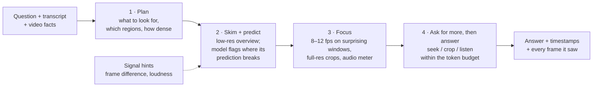

# Eval harness

vwatch ships with a harness that measures whether its way of watching beats the usual way of handing video to a model. This page covers the arms, the tasks, how to reproduce a run, the sandbox for third-party tools, the model backends and the repo layout. Results are in [benchmark.md](benchmark.md); the full protocol, metrics and ship/kill thresholds are in [eval-protocol.md](eval-protocol.md).

## Why

The default way to give a video to a language model is to sample frames evenly (say one per second) and send them with a transcript. Anything shorter than the gap between two frames can fall through: a flash frame, a half-second freeze, a dropped word, a price that is on screen for 400 ms. More frames help, but you pay for every one of them, including the hundreds where nothing happens.

People don't watch like that. They know what they are looking for, skim, notice when something breaks their expectation, and look closely there. vwatch gives a model the same loop and the tools to do it within a fixed token budget, and this harness measures whether it actually helps.

## Fair comparison

Every arm gets the **same model, the same task prompt and the same videos**; only how the video reaches the model changes. The headline comparison is at a **matched evidence-token budget**: every image and text block sent counts against the cap (images at w×h/750 tokens). Billed tokens, which include re-sent conversation history in the watcher's multi-turn loop, are reported separately as cost.

## How the watcher (arm W) works



1. **Plan first.** Before seeing a frame, the model reads the question, the video facts and the Whisper transcript, and writes down what it is looking for, which screen regions need a close look, and how densely to sample.
2. **Skim and predict.** It gets a cheap low-resolution overview (or, for a clip short enough to fit the budget, the whole clip at watchable size) plus hints from model-free signals (frame difference, loudness), which play the role of the retina. It predicts what should happen between frames and flags where that prediction is uncertain or wrong.
3. **Focus.** The most surprising windows are served at 8–12 fps, with full-resolution crops of the planned regions and an audio meter.
4. **Ask for more.** It can request extra `seek` / `crop` / `listen` calls within the budget, then answers with timestamps. Every frame, crop and audio window it looked at is logged, so a claim about a moment it never saw can be caught.

The Claude Code plugin keeps the method but drops the nested model: your own agent runs the loop with the same primitives as MCP tools (see [mcp.md](mcp.md)).

## Arms

| Arm | What reaches the model |
|---|---|
| B0 | N evenly spaced frames, no audio. How video is usually handled today. |
| B1 | B0 plus a timestamped Whisper transcript. **The main baseline.** |
| B2 | B1 at twice the budget. Is vwatch just buying more frames? |
| B1H | B1 plus the exact signal-hint text W receives. Isolates the method from the detectors. |
| W | vwatch's watcher: plan, skim + predict, focus, act. |
| W-noQ / W-noP / W-noCrop / W-noS | W without the plan / the prediction step (signals only) / crops / signal hints. |
| CC | Plain headless Claude Code (`claude -p`, normal system prompt) with Bash limited to ffmpeg/ffprobe and a few read-only commands, plus Read. |
| CVV | CC + the [claude-video-vision](https://github.com/jordanrendric/claude-video-vision) plugin, prompted with `/claude-video-vision:watch-video`; local whisper.cpp `small` for audio. |
| POP | CC + the [popcorn](https://github.com/haithamelmengad/popcorn) MCP server (mlx-whisper / faster-whisper in its own venv). |
| VWP | CC + the vwatch plugin from this checkout (`plugins/vwatch`: MCP tools + `watch-video` skill), prompted with `/vwatch:watch`. |

CC, CVV, POP and VWP are reference arms, not part of ship/kill. They are **not budget-capped** (that is how those tools are used), so compare them on accuracy, billed cost and wall time, not on the matched-budget curve.

## Tasks

| ID | Task | Ground truth |
|---|---|---|
| T1 | Defect detection: flash frame, frozen frame, jump cut, audio dropout, blocked caption, wrong on-screen number | Injected by script into clean real videos, so exact. T1x adds the generic types on Wikimedia Commons speech videos in six languages. |
| T2 | Short-event recall: "list every event", scored by event duration bucket | Procedurally rendered clips; the generator writes the event list |
| T3 | Causal retell: one "because" per sentence | Procedural cause→effect chains with distractors; scored by an LLM judge with a fixed rubric |
| T4 | Targeted QA: five questions per video, one right answer each | Procedural clips |
| T5 | Public benchmark check: 60 multiple-choice clips from TVBench | Benchmark labels |

How each set is built: [dataset-spec.md](dataset-spec.md). Sources and licenses: [DATA.md](DATA.md).

## Reproduce

You need Python 3.11+, [uv](https://docs.astral.sh/uv/), `ffmpeg` on `PATH`, and a model backend (see [Model backends](#model-backends)).

```bash
git clone https://github.com/kashaf12/vwatch.git
cd vwatch
uv sync --all-extras
```

Video files are not in the repo. Build the dataset locally (the procedural tasks need only ffmpeg; T1x and T5 download from Wikimedia Commons and Hugging Face; T1 needs your own clean videos, see [DATA.md](DATA.md#t1-bring-your-own-videos)):

```bash
uv run vw dataset build --root eval/data --scale full --seed 7 --tasks T2 T3 T4   # procedural clips
uv run python -m vwatch.dataset.t1x --root eval/data --seed 7                     # Commons speech videos + defects
uv run python -m vwatch.dataset.tvbench --root eval/data --per-category 10 --seed 7
```

Run arms and write the report (these call the model and cost money, see [cost notes](benchmark.md#cost-notes)):

```bash
uv run vw eval run --split pilot --tasks T2,T3 --arms B0,B1,B2,W,W-noQ,W-noP,W-noCrop --budget 25000
uv run vw eval report --runs 'eval/runs/*.jsonl' --root eval/data --budget 25000 --judge --out eval/results/pilot.md
```

- `eval run` is resumable: re-running skips finished (video, task) pairs and retries failed ones. Records go to `eval/runs/<date>_<arm>_<budget>k_r<repeat>.jsonl`.
- `--budget 10000,25000,50000,100000` gives the Pareto curve; `--repeats 3` is the full-run protocol; `--ids-file eval/bench/t5_ids.txt` runs a fixed id list.
- `eval report` without `--judge` makes no model calls (T3 is then n/a). With `--judge` it scores T3 with an LLM judge (default `sonnet`).
- `eval/bench/eval_signals.py` measures the signal detectors alone (recall, precision, false alarms per clean minute) with no model calls.

## External arms

`scripts/setup_external.sh` clones claude-video-vision, popcorn and whisper.cpp at pinned commits into `vendor/` (gitignored), builds them and downloads their models; nothing is installed into `~/.claude` or system-wide. It needs git, node ≥ 24, npm, uv and ffmpeg. VWP needs only uv: it runs the plugin and MCP server from this checkout.

```bash
scripts/setup_external.sh
uv run vw eval run --split pilot --tasks T1 --arms CC,CVV,POP,VWP --budget 25000
```

Each external run copies the video to a fresh temp dir under a neutral name, runs `claude` there with no user settings, CLAUDE.md, hooks, plugins or MCP servers (`--setting-sources ""`, `--strict-mcp-config`), `--permission-mode dontAsk` with an allowlist and no web tools, kills the process tree after 15 min (`VWATCH_EXT_TIMEOUT_S`), and audits every tool call. A call that touches a path outside the workdir, the repo or a truth file turns the run into an `audit:` error, which counts as a failure. Tool calls and the audit are logged to `eval/runs/external/`.

## Model backends

The watcher and baseline arms (and `vw watch`) call a model through one of two backends. The MCP tools and the plugin never do.

| Backend | When | Notes |
|---|---|---|
| Anthropic SDK | `ANTHROPIC_API_KEY` is set | Billed to your API account. Installed by `uv sync --all-extras` (the `api` extra). |
| Claude Code CLI | no API key, or `VWATCH_BACKEND=cli` | Runs `claude -p` in stream-json mode with no tools, no MCP and a replaced system prompt. Uses your logged-in Claude Code, so **usage counts against your Claude plan**. Set `VWATCH_CLAUDE_BIN` if `claude` is not on `PATH`. |

The default model is `claude-opus-5-5` (`--model` to change it, `--effort` for reasoning effort).

| Variable | Default | Purpose |
|---|---|---|
| `VWATCH_BACKEND` | auto | `cli` forces the Claude Code CLI even when an API key is set |
| `VWATCH_WHISPER_MODEL` | `small` | faster-whisper model name |
| `VWATCH_WHISPER_DEVICE` | `auto` | `auto` tries `mps`, then falls back to CPU int8; set `cuda` for an NVIDIA GPU or `cpu` |
| `VWATCH_CACHE` | `~/.cache/vwatch` | transcript cache (and the static ffmpeg download) |
| `VWATCH_FFMPEG` / `VWATCH_FFPROBE` | from `PATH`, else a static build | explicit ffmpeg / ffprobe binaries |
| `VWATCH_SHORTS_DIR` | `eval/sources/shorts` | your own clean videos for T1 ([DATA.md](DATA.md#t1-bring-your-own-videos)) |
| `VWATCH_EXT_TIMEOUT_S` | 900 | per-run timeout for the external arms |
| `VWATCH_VENDOR_DIR` / `VWATCH_EXT_LOG_DIR` | `vendor/` / `eval/runs/external/` | where the external tools live and where their logs go |

Plugin launcher variables (`VWATCH_UV_INSTALL`, `VWATCH_SPEC`) are described in [mcp.md](mcp.md#install).

## Repo layout

| Path | What |
|---|---|
| `src/vwatch/cli.py` | The `vw` command ([cli.md](cli.md)) |
| `src/vwatch/mcp_tools.py`, `mcp_server.py` | The video tools for your own agent, and the MCP server (`vwatch-mcp`) |
| `plugins/vwatch/`, `.claude-plugin/marketplace.json` | Claude Code plugin (MCP server, `watch-video` skill, `/vwatch:watch`) and its marketplace |
| `src/vwatch/media.py`, `imaging.py` | ffmpeg I/O, frame grids, crops, timestamps, token estimates |
| `src/vwatch/signals.py` | Model-free perception: flashes, cuts, freezes, silences, local changes |
| `src/vwatch/detectors.py` | Full-pass freeze and jump-cut detectors (mid-res stillness, catch-up jump, audio splice click on a frame boundary) |
| `src/vwatch/transcribe.py` | Whisper transcript with word timestamps, cached |
| `src/vwatch/llm/` | Backends: Anthropic SDK, Claude Code CLI, a fake for tests, the T3 judge |
| `src/vwatch/arms/` | `watcher.py` (W and ablations), `tools.py` (overview / seek / crop / listen), `baseline.py` (B0/B1/B2/B1H), `external*.py` (CC/CVV/POP/VWP, sandbox and audit) |
| `src/vwatch/tasks.py` | Task prompts (identical across arms) and answer parsing |
| `src/vwatch/dataset/` | Dataset builders: defect injection (T1, T1x), procedural clips (T2–T4), TVBench (T5) |
| `src/vwatch/evaluation/` | Runner, scoring, statistics (clustered bootstrap, McNemar), criteria, report and charts |
| `eval/results/` | Reports and charts |
| `eval/bench/` | Fixed video-id lists for benchmark runs, the signal-only evaluation, chart script |
| `docs/` | [Benchmark](benchmark.md), [eval protocol](eval-protocol.md), [dataset spec](dataset-spec.md), [data and licenses](DATA.md), [MCP reference](mcp.md), [CLI](cli.md), [roadmap](roadmap.md) |
| `scripts/setup_external.sh` | Pinned install of the third-party tools for the external arms |
| `scripts/smoke_mcp.py` | Fresh-install smoke test: starts the plugin's server and calls the tools over MCP |
| `tests/` | ~620 tests; fakes only, no network or model calls |

## Citing

If you use vwatch or its eval harness, please cite it. GitHub's "Cite this repository" button reads [CITATION.cff](../CITATION.cff); the same entry as BibTeX:

```bibtex
@software{vwatch2026,
  author  = {kashaf12},
  title   = {vwatch: an agent toolkit that watches video like a person},
  year    = {2026},
  version = {0.1.0},
  url     = {https://github.com/kashaf12/vwatch},
  license = {MIT}
}
```

If you use the T5 subset, also cite TVBench ([DATA.md](DATA.md#t5-tvbench-subset)).
