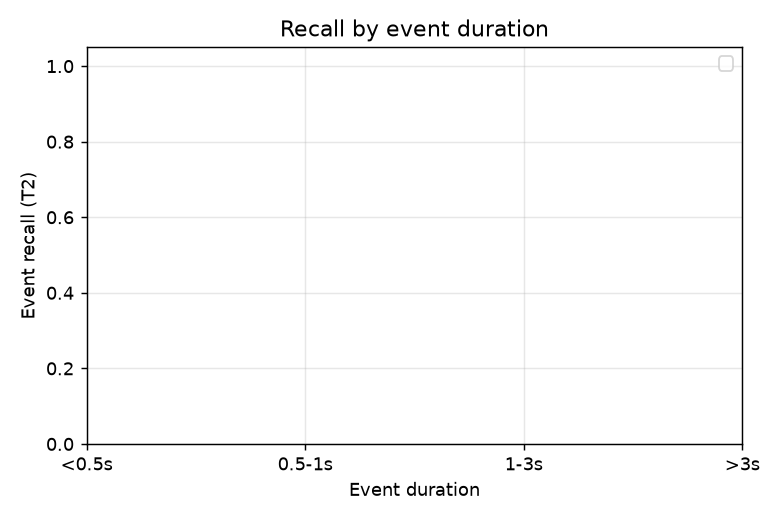
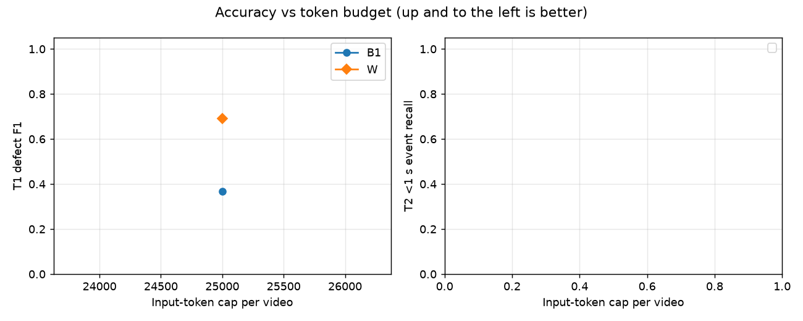

# Eval result: 2026-11-22

- Model + version: claude-opus-5-5
- Watcher commit: n/a
- Thresholds locked on: n/a
- Repeats per arm: 1

## Headline

`W vs B1 @25k tokens: T1 F1 0.69 vs 0.37 (+32.4 pp, CI [+11.1, +54.7]), <1s recall n/a, cost 1.00×`

Verdict: INCOMPLETE

## Scorecard (matched budget)

| Criterion | Target | B1 (M1: B1H) | W | Δ | 95% CI | Pass? |
|---|---|---|---|---|---|---|
| S1 Defect F1 | >=0.85 abs and >=+15pp over B1 (CI>0) | 0.37 | 0.69 | +32.4 pp | [+11.1, +54.7] | fail |
| S2 <1 s event recall | >=+25pp over B1 (CI>0) and W precision >= B1 - 10pp | n/a | n/a | n/a | n/a | n/a |
| S3 Localization +-0.5 s | >=90% | 23.3% | 60.0% | +36.7 pp | n/a | fail |
| S4 False alarms (clean) | <=5% | 0.0% | 0.0% | +0.0 pp | n/a | pass |
| S5 Causal link recall | >=+15pp over B1 (CI>0), invented <= B1 | n/a | n/a | n/a | n/a | n/a |
| S6 Cost vs B1 | <=1.5x $/video-minute | $0.2788/min | $0.2801/min | 1.00× | n/a | pass |
| S7 W@X vs B1@2X | W wins on T1 F1 (CI>0) | n/a | 0.69 | n/a | n/a | n/a |
| S8 Unseen-frame claims | 0 in T1 | 0 | 0 | n/a | n/a | pass |
| M1 W vs B1H on T1 F1 (method-only) | informational, non-gating | n/a | 0.69 | n/a | n/a | info |

S3 = localized (±0.5 s) defects ÷ ALL truth defects; S2 also needs W T2 precision >= B1 - 10 pp.

| Kill rule | Condition | Status |
|---|---|---|
| K1 Gain < 5pp on T1 and T2 | kill if both gains < 5pp | n/a |
| K2 B2 matches W on T1 | kill if W - B2@2X F1 < 2pp | n/a |
| K3 Ablations within 3pp | kill if all three within 3pp of W | n/a |

## Recall by event duration

| Bucket |
|---|
| <0.5s |
| 0.5-1s |
| 1-3s |
| >3s |

## Pareto (T1 F1 / <1 s event recall vs token cap)

| Cap | B1 F1 | W F1 | B1 <1s recall | W <1s recall |
|---|---|---|---|---|
| 25k | 0.37 | 0.69 | n/a | n/a |

## Ablations

| Arm | T1 F1 | <1 s recall | Causal recall | W minus this arm (T1 F1) |
|---|---|---|---|---|
| W | 0.69 | n/a | n/a | — |
| W-noQ | n/a | n/a | n/a | n/a |
| W-noP | 0.72 | n/a | n/a | -3.1 pp CI [-11.8, +7.2] |
| W-noCrop | n/a | n/a | n/a | n/a |

## Method-only comparison

No B1H / W-noS cells at the matched budget (n/a).

## T1 F1 per source clip (matched budget)

| Source | B1 | CC | CVV | POP | W | W-noP |
|---|---|---|---|---|---|---|
| bnreel | 0.00 | 0.80 | 0.80 | 0.80 | 0.50 | 0.00 |
| boston | 0.80 | 0.80 | 1.00 | 1.00 | 0.80 | 0.80 |
| gujarat | 0.00 | 1.00 | 1.00 | 0.86 | 0.80 | 0.80 |
| jharkhand | 0.50 | 0.57 | 0.80 | 0.75 | 0.80 | 0.80 |
| khizr | 0.50 | 0.80 | 0.80 | 0.80 | 0.67 | 0.80 |
| linagora | 0.00 | 1.00 | 0.80 | 0.80 | 0.80 | 0.80 |
| pietra | 0.50 | 1.00 | 0.80 | 0.80 | 0.80 | 0.80 |
| prague | 0.50 | 0.80 | 0.80 | 0.80 | 0.29 | 0.50 |
| sem | 0.50 | 0.80 | 0.80 | 0.86 | 0.80 | 0.80 |
| steel | 0.00 | 1.00 | 0.80 | 1.00 | 0.80 | 0.80 |

## Precision, strictness and failures

| Arm@budget | T2 precision | T2 events listed/video | T1 strict recall (±0.5 s) | T1 loc | found | Failure rate |
|---|---|---|---|---|---|
| B1@25000 | n/a | n/a | 23.3% | 100.0% | 0.0% |
| CC@25000 | n/a | n/a | 80.0% | 100.0% | 0.0% |
| CVV@25000 | n/a | n/a | 73.3% | 100.0% | 0.0% |
| POP@25000 | n/a | n/a | 83.3% | 100.0% | 0.0% |
| W@25000 | n/a | n/a | 60.0% | 100.0% | 0.0% |
| W-noP@25000 | n/a | n/a | 56.7% | 100.0% | 0.0% |

## Per-defect-type recall

| Type | B1 | W |
|---|---|---|
| Flash frame | 14.3% | 100.0% |
| Frozen frame | 71.4% | 42.9% |
| Jump cut | 12.5% | 0.0% |
| Audio dropout | 0.0% | 100.0% |
| Caption blocked | n/a | n/a |
| Wrong number | n/a | n/a |

## All arms: cost and honesty

| Arm@budget | Records | Videos | T1 F1 | T1 prec | T1 rec | T2 rec | T3 rec | T4 acc | In tok | Content tok | $/min | Wall s/min | Unseen T1 | T1 F1 std | Failed runs | Fail rate |
|---|---|---|---|---|---|---|---|---|---|---|---|---|---|---|---|---|
| B1@25000 | 40 | 40 | 0.37 | 0.88 | 0.23 | n/a | n/a | n/a | 27234 | 24489 | 0.2788 | 8.3 | 0 | n/a | 0 | 0.0% |
| CC@25000 | 40 | 40 | 0.86 | 0.92 | 0.80 | n/a | n/a | n/a | 154581 | 0 | 0.2967 | 66.1 | 26 | n/a | 0 | 0.0% |
| CVV@25000 | 40 | 40 | 0.85 | 1.00 | 0.73 | n/a | n/a | n/a | 234145 | 0 | 0.3718 | 61.2 | 1 | n/a | 0 | 0.0% |
| POP@25000 | 40 | 40 | 0.85 | 0.86 | 0.83 | n/a | n/a | n/a | 305874 | 0 | 0.4583 | 101.9 | 7 | n/a | 0 | 0.0% |
| W@25000 | 40 | 40 | 0.69 | 0.82 | 0.60 | n/a | n/a | n/a | 35900 | 14688 | 0.2801 | 36.3 | 0 | n/a | 0 | 0.0% |
| W-noP@25000 | 40 | 40 | 0.72 | 1.00 | 0.57 | n/a | n/a | n/a | 30626 | 12199 | 0.1795 | 24.3 | 0 | n/a | 0 | 0.0% |

## Notes / failures worth reading

- Criteria n/a (missing data): S2, S5, S7, K1, K2, K3.
- T3 not scored: no judge supplied.
- McNemar W vs B1, T1 found/missed: W-only 14, B1-only 3, n=30, p=0.0127.
- Bootstrap: 10000 resamples, 95% percentile CI, repeats averaged per video. T1 resamples whole source clips (cluster bootstrap); T2/T3/T4 resample videos.
- McNemar tests are per-item and not cluster-adjusted: descriptive only.
- Unseen claims count only frame/crop/audio observations within 0.5 s; hint- or transcript-only claims are unverified.
