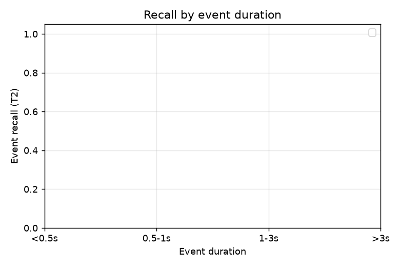
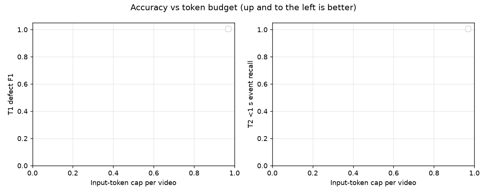

# Plugin benchmark: TVBench held-out (24 questions), 2026-11-23

`eval/bench/t5_heldout_ids.txt`. VWP run on 2026-11-23 (`2026-11-23h_VWP`); all other arms from 2026-11-22 (`2026-11-22c_*`, W after the full-view fix). In the tables below, Δ is W minus the row's arm.

- Model + version: claude-opus-5-5
- Watcher commit: n/a
- Thresholds locked on: n/a
- Repeats per arm: 1

## Headline

`W vs B1 @25k tokens: T1 F1 n/a vs n/a (n/a, CI n/a), <1s recall n/a, cost 0.94×`

Verdict: INCOMPLETE

## Scorecard (matched budget)

| Criterion | Target | B1 (M1: B1H) | W | Δ | 95% CI | Pass? |
|---|---|---|---|---|---|---|
| S1 Defect F1 | >=0.85 abs and >=+15pp over B1 (CI>0) | n/a | n/a | n/a | n/a | n/a |
| S2 <1 s event recall | >=+25pp over B1 (CI>0) and W precision >= B1 - 10pp | n/a | n/a | n/a | n/a | n/a |
| S3 Localization +-0.5 s | >=90% | n/a | n/a | n/a | n/a | n/a |
| S4 False alarms (clean) | <=5% | n/a | n/a | n/a | n/a | n/a |
| S5 Causal link recall | >=+15pp over B1 (CI>0), invented <= B1 | n/a | n/a | n/a | n/a | n/a |
| S6 Cost vs B1 | <=1.5x $/video-minute | $0.8029/min | $0.7561/min | 0.94× | n/a | pass |
| S7 W@X vs B1@2X | W wins on T1 F1 (CI>0) | n/a | n/a | n/a | n/a | n/a |
| S8 Unseen-frame claims | 0 in T1 | n/a | n/a | n/a | n/a | n/a |
| M1 W vs B1H on T1 F1 (method-only) | informational, non-gating | n/a | n/a | n/a | n/a | info |

S3 = localized (±0.5 s) defects ÷ ALL truth defects; S2 also needs W T2 precision >= B1 - 10 pp.

| Kill rule | Condition | Status |
|---|---|---|
| K1 Gain < 5pp on T1 and T2 | kill if both gains < 5pp | n/a |
| K2 B2 matches W on T1 | kill if W - B2@2X F1 < 2pp | n/a |
| K3 Ablations within 3pp | kill if all three within 3pp of W | n/a |

## Recall by event duration

| Bucket |
|---|
| <0.5s |
| 0.5-1s |
| 1-3s |
| >3s |

## Pareto (T1 F1 / <1 s event recall vs token cap)

| Cap | B1 F1 | W F1 | B1 <1s recall | W <1s recall |
|---|---|---|---|---|
| 25k | n/a | n/a | n/a | n/a |

## Ablations

| Arm | T1 F1 | <1 s recall | Causal recall | W minus this arm (T1 F1) |
|---|---|---|---|---|
| W | n/a | n/a | n/a | — |
| W-noQ | n/a | n/a | n/a | n/a |
| W-noP | n/a | n/a | n/a | n/a |
| W-noCrop | n/a | n/a | n/a | n/a |

## Method-only comparison

No B1H / W-noS cells at the matched budget (n/a).

## T1 F1 per source clip (matched budget)

n/a

## Precision, strictness and failures

| Arm@budget | T2 precision | T2 events listed/video | T1 strict recall (±0.5 s) | T1 loc | found | Failure rate |
|---|---|---|---|---|---|
| B1@25000 | n/a | n/a | n/a | n/a | 0.0% |
| CC@25000 | n/a | n/a | n/a | n/a | 0.0% |
| CVV@25000 | n/a | n/a | n/a | n/a | 0.0% |
| POP@25000 | n/a | n/a | n/a | n/a | 0.0% |
| VWP@25000 | n/a | n/a | n/a | n/a | 0.0% |
| W@25000 | n/a | n/a | n/a | n/a | 0.0% |
| W-noP@25000 | n/a | n/a | n/a | n/a | 0.0% |

## Public benchmark (TVBench subset)

Multiple-choice video QA from TVBench (CC-BY-4.0, FunAILab); informational, not part of the S/K criteria. Accuracy = correct items / items; a missing or invalid letter is wrong. Δ = W@matched budget minus the row's arm, 95% CI is a paired bootstrap over videos.

| Arm@budget | Videos | action_localization | action_sequence | moving_direction | object_count | scene_transition | unexpected_action | Overall | Δ vs W | 95% CI |
|---|---|---|---|---|---|---|---|---|---|---|
| B1@25000 | 24 | 100.0% | 100.0% | 100.0% | 50.0% | 100.0% | 75.0% | 87.5% | +8.3 pp | [+0.0, +20.8] |
| CC@25000 | 24 | 100.0% | 100.0% | 100.0% | 100.0% | 100.0% | 75.0% | 95.8% | +0.0 pp | [+0.0, +0.0] |
| CVV@25000 | 24 | 100.0% | 100.0% | 100.0% | 100.0% | 100.0% | 75.0% | 95.8% | +0.0 pp | [+0.0, +0.0] |
| POP@25000 | 24 | 100.0% | 100.0% | 100.0% | 100.0% | 100.0% | 50.0% | 91.7% | +4.2 pp | [+0.0, +12.5] |
| VWP@25000 | 24 | 100.0% | 100.0% | 100.0% | 75.0% | 100.0% | 75.0% | 91.7% | +4.2 pp | [+0.0, +12.5] |
| W@25000 | 24 | 100.0% | 100.0% | 100.0% | 100.0% | 100.0% | 75.0% | 95.8% | n/a | n/a |
| W-noP@25000 | 24 | 100.0% | 100.0% | 100.0% | 75.0% | 100.0% | 75.0% | 91.7% | +4.2 pp | [+0.0, +12.5] |
| chance (guessing) |  | 25.0% | 50.0% | 25.0% | 25.0% | 50.0% | 25.0% | 33.3% |  |  |

## Per-defect-type recall

| Type | B1 | W |
|---|---|---|
| Flash frame | n/a | n/a |
| Frozen frame | n/a | n/a |
| Jump cut | n/a | n/a |
| Audio dropout | n/a | n/a |
| Caption blocked | n/a | n/a |
| Wrong number | n/a | n/a |

## All arms: cost and honesty

| Arm@budget | Records | Videos | T1 F1 | T1 prec | T1 rec | T2 rec | T3 rec | T4 acc | In tok | Content tok | $/min | Wall s/min | Unseen T1 | T1 F1 std | Failed runs | Fail rate |
|---|---|---|---|---|---|---|---|---|---|---|---|---|---|---|---|---|
| B1@25000 | 24 | 24 | n/a | n/a | n/a | n/a | n/a | n/a | 23694 | 21267 | 0.8029 | 17.6 | n/a | n/a | 0 | 0.0% |
| CC@25000 | 24 | 24 | n/a | n/a | n/a | n/a | n/a | n/a | 19709 | 0 | 0.1731 | 43.1 | n/a | n/a | 0 | 0.0% |
| CVV@25000 | 24 | 24 | n/a | n/a | n/a | n/a | n/a | n/a | 50118 | 0 | 0.4359 | 35.2 | n/a | n/a | 0 | 0.0% |
| POP@25000 | 24 | 24 | n/a | n/a | n/a | n/a | n/a | n/a | 33277 | 0 | 0.2733 | 49.8 | n/a | n/a | 0 | 0.0% |
| VWP@25000 | 24 | 24 | n/a | n/a | n/a | n/a | n/a | n/a | 36224 | 0 | 0.4202 | 46.1 | n/a | n/a | 0 | 0.0% |
| W@25000 | 24 | 24 | n/a | n/a | n/a | n/a | n/a | n/a | 23974 | 12204 | 0.7561 | 63.9 | n/a | n/a | 0 | 0.0% |
| W-noP@25000 | 24 | 24 | n/a | n/a | n/a | n/a | n/a | n/a | 12721 | 10177 | 0.4095 | 37.7 | n/a | n/a | 0 | 0.0% |

## Notes / failures worth reading

- Criteria n/a (missing data): S1, S2, S3, S4, S5, S7, S8, K1, K2, K3.
- T3 not scored: no judge supplied.
- Bootstrap: 10000 resamples, 95% percentile CI, repeats averaged per video. T1 resamples whole source clips (cluster bootstrap); T2/T3/T4 resample videos.
- McNemar tests are per-item and not cluster-adjusted: descriptive only.
- Unseen claims count only frame/crop/audio observations within 0.5 s; hint- or transcript-only claims are unverified.
