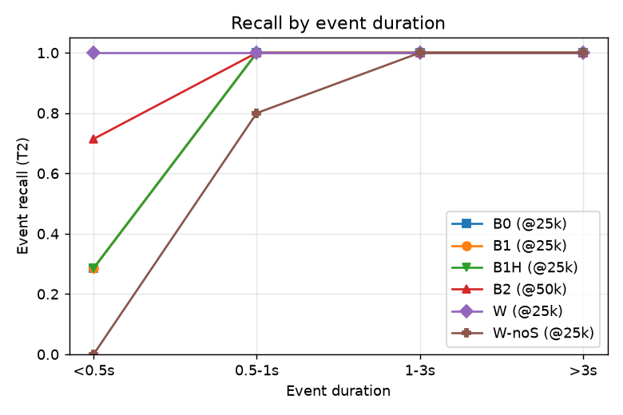
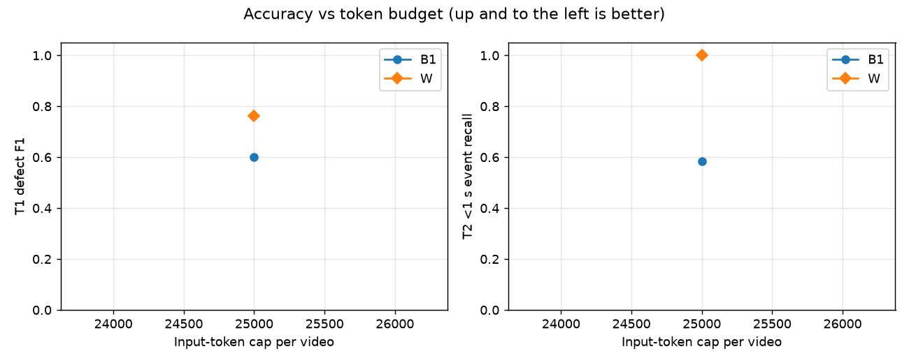

# Eval result: 2026-11-22

- Model + version: claude-opus-5-5
- Watcher commit: n/a
- Thresholds locked on: n/a
- Repeats per arm: 1

## Headline

`W vs B1 @25k tokens: T1 F1 0.76 vs 0.60 (+16.2 pp, CI [-25.0, +44.6]), <1s recall +41.7 pp, cost 1.36×`

Verdict: ITERATE

## Scorecard (matched budget)

| Criterion | Target | B1 (M1: B1H) | W | Δ | 95% CI | Pass? |
|---|---|---|---|---|---|---|
| S1 Defect F1 | >=0.85 abs and >=+15pp over B1 (CI>0) | 0.60 | 0.76 | +16.2 pp | [-25.0, +44.6] | fail |
| S2 <1 s event recall | >=+25pp over B1 (CI>0) and W precision >= B1 - 10pp | 58.3% | 100.0% | +41.7 pp | [+28.6, +60.0] | pass |
| S3 Localization +-0.5 s | >=90% | 54.5% | 72.7% | +18.2 pp | n/a | fail |
| S4 False alarms (clean) | <=5% | 50.0% | 50.0% | +0.0 pp | n/a | fail |
| S5 Causal link recall | >=+15pp over B1 (CI>0), invented <= B1 | 85.7% | 100.0% | +14.3 pp | [+0.0, +33.3] | fail |
| S6 Cost vs B1 | <=1.5x $/video-minute | $0.3172/min | $0.4309/min | 1.36× | n/a | pass |
| S7 W@X vs B1@2X | W wins on T1 F1 (CI>0) | 0.59 | 0.76 | +17.4 pp | [+0.0, +32.5] | fail |
| S8 Unseen-frame claims | 0 in T1 | 0 | 0 | n/a | n/a | pass |
| M1 W vs B1H on T1 F1 (method-only) | informational, non-gating | 0.55 | 0.76 | +21.0 pp | [+0.0, +30.8] | info |

S3 = localized (±0.5 s) defects ÷ ALL truth defects; S2 also needs W T2 precision >= B1 - 10 pp.

| Kill rule | Condition | Status |
|---|---|---|
| K1 Gain < 5pp on T1 and T2 | kill if both gains < 5pp | clear |
| K2 B2 matches W on T1 | kill if W - B2@2X F1 < 2pp | clear |
| K3 Ablations within 3pp | kill if all three within 3pp of W | clear |

## Recall by event duration

| Bucket | B0 (@25k) | B1 (@25k) | B1H (@25k) | B2 (@50k) | W (@25k) | W-noS (@25k) |
|---|---|---|---|---|---|---|
| <0.5s | 28.6% | 28.6% | 28.6% | 71.4% | 100.0% | 0.0% |
| 0.5-1s | 100.0% | 100.0% | 100.0% | 100.0% | 100.0% | 80.0% |
| 1-3s | 100.0% | 100.0% | 100.0% | 100.0% | 100.0% | 100.0% |
| >3s | 100.0% | 100.0% | 100.0% | 100.0% | 100.0% | 100.0% |

## Pareto (T1 F1 / <1 s event recall vs token cap)

| Cap | B1 F1 | W F1 | B1 <1s recall | W <1s recall |
|---|---|---|---|---|
| 25k | 0.60 | 0.76 | 58.3% | 100.0% |

## Ablations

| Arm | T1 F1 | <1 s recall | Causal recall | W minus this arm (T1 F1) |
|---|---|---|---|---|
| W | 0.76 | 100.0% | 100.0% | — |
| W-noQ | 0.59 | 83.3% | 100.0% | +16.9 pp CI [+6.0, +22.7] |
| W-noP | 0.80 | 100.0% | 100.0% | -3.8 pp CI [-16.7, +8.9] |
| W-noCrop | 0.80 | 100.0% | 85.7% | -3.8 pp CI [-11.0, +0.0] |
| B1H | 0.55 | 58.3% | 85.7% | +21.0 pp CI [+0.0, +30.8] |
| W-noS | 0.63 | 33.3% | 85.7% | +13.0 pp CI [+0.0, +28.5] |

## Method-only comparison

W vs B1H (same signal hint text, plain frames) isolates the method from the hints. W - W-noS is the contribution of the signal hints/candidates. CIs are cluster bootstraps (T1 by source clip, others by video).

### W vs B1H (method-only)

| Metric | W | B1H | Δ | 95% CI |
|---|---|---|---|---|
| T1 F1 | 0.76 | 0.55 | +21.0 pp | [+0.0, +30.8] |
| T2 <1 s recall | 100.0% | 58.3% | +41.7 pp | [+28.6, +60.0] |
| T2 precision | 100.0% | 100.0% | +0.0 pp | [+0.0, +0.0] |
| T4 accuracy | 100.0% | 80.0% | +20.0 pp | [+0.0, +40.0] |

### Signal contribution: W - W-noS

| Metric | W | W-noS | Δ | 95% CI |
|---|---|---|---|---|
| T1 F1 | 0.76 | 0.63 | +13.0 pp | [+0.0, +28.5] |
| T2 <1 s recall | 100.0% | 33.3% | +66.7 pp | [+60.0, +71.4] |
| T2 precision | 100.0% | 100.0% | +0.0 pp | [+0.0, +0.0] |
| T4 accuracy | 100.0% | 90.0% | +10.0 pp | [+0.0, +20.0] |

## T1 F1 per source clip (matched budget)

| Source | B0 | B1 | B1H | W | W-noCrop | W-noP | W-noQ | W-noS |
|---|---|---|---|---|---|---|---|---|
| dosa-demo-stick-story | 0.33 | 0.29 | 0.67 | 0.86 | 1.00 | 1.00 | 0.86 | 0.80 |
| dosa-reel-DEMO | 0.40 | 0.40 | 0.33 | 0.67 | 0.67 | 0.67 | 0.44 | 0.33 |
| dosa-stall-bengaluru-2026-11-13T18-15-12 | 0.67 | 1.00 | 0.67 | 0.67 | 0.67 | 0.50 | 0.50 | 0.67 |
| dosa-stall-bengaluru-2026-11-13T18-39-54 | 0.67 | 1.00 | 0.80 | 0.80 | 0.80 | 1.00 | 0.57 | 0.80 |

## Precision, strictness and failures

| Arm@budget | T2 precision | T2 events listed/video | T1 strict recall (±0.5 s) | T1 loc | found | Failure rate |
|---|---|---|---|---|---|
| B0@25000 | 100.0% | 7.00 | 36.4% | 100.0% | 0.0% |
| B1@25000 | 100.0% | 7.00 | 54.5% | 100.0% | 0.0% |
| B1H@25000 | 100.0% | 7.00 | 72.7% | 100.0% | 0.0% |
| B2@50000 | 100.0% | 8.50 | 45.5% | 100.0% | 0.0% |
| W@25000 | 100.0% | 9.50 | 72.7% | 100.0% | 0.0% |
| W-noCrop@25000 | 100.0% | 9.50 | 72.7% | 100.0% | 0.0% |
| W-noP@25000 | 100.0% | 9.50 | 72.7% | 100.0% | 0.0% |
| W-noQ@25000 | 100.0% | 8.50 | 72.7% | 100.0% | 0.0% |
| W-noS@25000 | 100.0% | 5.50 | 54.5% | 100.0% | 0.0% |

## Per-defect-type recall

| Type | B1 | W |
|---|---|---|
| Flash frame | 0.0% | 100.0% |
| Frozen frame | 100.0% | 0.0% |
| Jump cut | 0.0% | 0.0% |
| Audio dropout | 50.0% | 100.0% |
| Caption blocked | 100.0% | 100.0% |
| Wrong number | 100.0% | 100.0% |

## All arms: cost and honesty

| Arm@budget | Records | Videos | T1 F1 | T1 prec | T1 rec | T2 rec | T3 rec | T4 acc | In tok | Content tok | $/min | Wall s/min | Unseen T1 | T1 F1 std | Failed runs | Fail rate |
|---|---|---|---|---|---|---|---|---|---|---|---|---|---|---|---|---|
| B0@25000 | 19 | 19 | 0.47 | 0.67 | 0.36 | 0.74 | 0.86 | 0.90 | 25013 | 24532 | 0.3088 | 12.3 | 0 | n/a | 0 | 0.0% |
| B1@25000 | 19 | 19 | 0.60 | 0.67 | 0.55 | 0.74 | 0.86 | 0.90 | 25392 | 24712 | 0.3172 | 14.2 | 0 | n/a | 0 | 0.0% |
| B1H@25000 | 19 | 19 | 0.55 | 0.44 | 0.73 | 0.74 | 0.86 | 0.80 | 25586 | 24628 | 0.3251 | 16.8 | 0 | n/a | 0 | 0.0% |
| B2@50000 | 19 | 19 | 0.59 | 0.83 | 0.45 | 0.89 | 0.86 | 0.90 | 49980 | 49459 | 0.6020 | 13.7 | 0 | n/a | 0 | 0.0% |
| W@25000 | 19 | 19 | 0.76 | 0.80 | 0.73 | 1.00 | 1.00 | 1.00 | 52240 | 19120 | 0.4309 | 52.3 | 0 | n/a | 0 | 0.0% |
| W-noCrop@25000 | 19 | 19 | 0.80 | 0.89 | 0.73 | 1.00 | 0.86 | 1.00 | 46856 | 17401 | 0.3770 | 45.0 | 0 | n/a | 0 | 0.0% |
| W-noP@25000 | 19 | 19 | 0.80 | 0.89 | 0.73 | 1.00 | 1.00 | 1.00 | 35969 | 16878 | 0.2790 | 32.5 | 0 | n/a | 0 | 0.0% |
| W-noQ@25000 | 19 | 19 | 0.59 | 0.50 | 0.73 | 0.89 | 1.00 | 1.00 | 43424 | 17189 | 0.3773 | 45.0 | 0 | n/a | 0 | 0.0% |
| W-noS@25000 | 19 | 19 | 0.63 | 0.75 | 0.55 | 0.58 | 0.86 | 0.90 | 61677 | 19843 | 0.4096 | 52.0 | 0 | n/a | 0 | 0.0% |

## Notes / failures worth reading

- McNemar W vs B1, T1 found/missed: W-only 3, B1-only 1, n=11, p=0.6250.
- McNemar W vs B1, T2 <1 s found/missed: W-only 5, B1-only 0, n=12, p=0.0625.
- Invented causal links per video: W 0.50, B1 0.50.
- Bootstrap: 10000 resamples, 95% percentile CI, repeats averaged per video. T1 resamples whole source clips (cluster bootstrap); T2/T3/T4 resample videos.
- McNemar tests are per-item and not cluster-adjusted: descriptive only.
- Unseen claims count only frame/crop/audio observations within 0.5 s; hint- or transcript-only claims are unverified.
